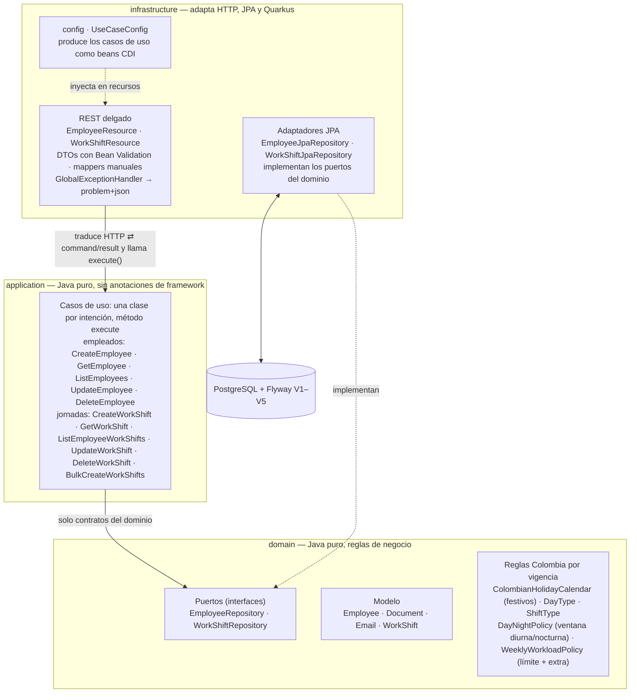
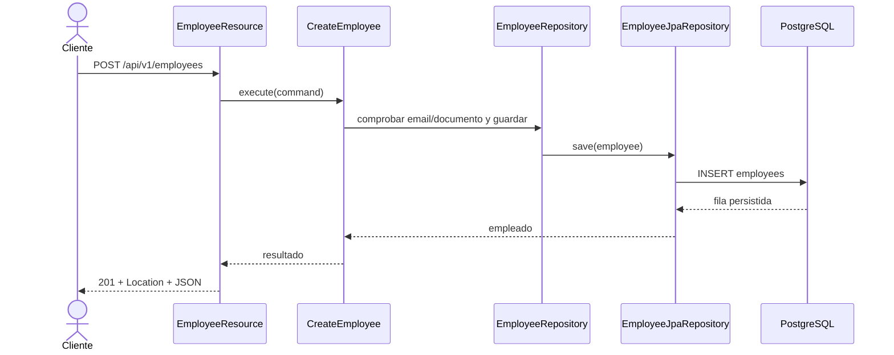
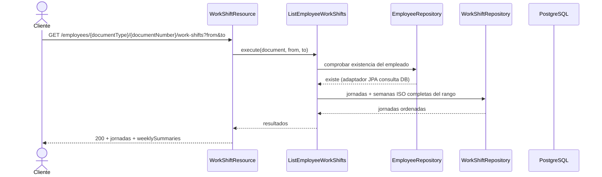
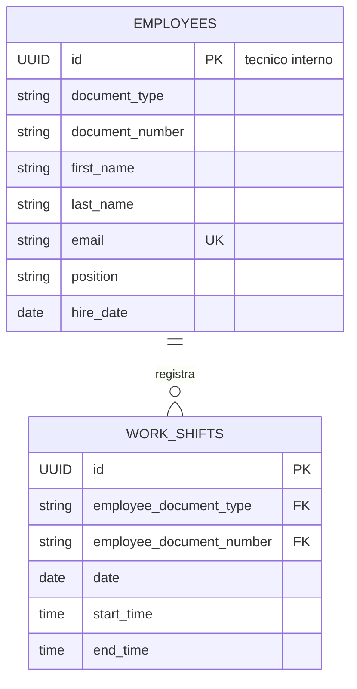

# Employees API

API REST para administrar empleados y sus jornadas laborales según reglas de Colombia. Está implementada con Java 21, Quarkus, PostgreSQL y Flyway, con separación de responsabilidades basada en Clean Architecture. No incluye interfaz web propia: Swagger UI es la interfaz interactiva de demostración.

## Requisitos y ejecución

Requisitos locales: Java 21. El Maven Wrapper incluido descarga Maven 3.9.9; desde esta carpeta ejecuta:

```powershell
.\mvnw.cmd quarkus:dev
```

Para levantar la API y PostgreSQL con Docker:

```powershell
docker compose up --build
```

Flyway crea el esquema y carga empleados y jornadas de ejemplo. URLs locales:

- Swagger UI: <http://localhost:8080/q/swagger-ui>
- OpenAPI: <http://localhost:8080/q/openapi>
- Salud: <http://localhost:8080/q/health>

En desarrollo y pruebas, Quarkus usa Dev Services por defecto. En entornos donde el cliente Docker de Dev Services no sea compatible con el daemon, se puede usar el PostgreSQL de Compose:

```powershell
docker compose up -d postgres
.\mvnw.cmd '-DTEST_DB_DEV_SERVICES=false' '-DTEST_DATASOURCE_URL=jdbc:postgresql://localhost:5432/employees_api_v2' verify
```

## Contrato REST

Prefijo: `/api/v1`. Los errores se responden como `application/problem+json` (ver "Errores" más abajo). Los POST exitosos devuelven `201 Created` y un encabezado `Location`; los DELETE exitosos devuelven `204 No Content`.

| Método | Ruta | Resultado |
|---|---|---|
| POST | `/employees` | Crea un empleado |
| GET | `/employees?page=0&size=20` | Lista empleados paginados (`size` máximo 100) |
| GET | `/employees/{documentType}/{documentNumber}` | Obtiene un empleado por documento |
| PUT | `/employees/{documentType}/{documentNumber}` | Actualización parcial: solo los campos enviados se actualizan; documento y `hireDate` inmutables |
| DELETE | `/employees/{documentType}/{documentNumber}` | Elimina empleado y jornadas asociadas |
| POST | `/employees/{documentType}/{documentNumber}/work-shifts` | Agrega una jornada |
| GET | `/employees/{documentType}/{documentNumber}/work-shifts` | Lista jornadas y resúmenes semanales; acepta `from` y `to` |
| GET | `/employees/{documentType}/{documentNumber}/work-shifts/{shiftId}` | Obtiene una jornada bajo su empleado |
| PUT | `/employees/{documentType}/{documentNumber}/work-shifts/{shiftId}` | Reemplaza fecha y horario de la jornada |
| DELETE | `/employees/{documentType}/{documentNumber}/work-shifts/{shiftId}` | Elimina una jornada |
| POST | `/employees/{documentType}/{documentNumber}/work-shifts/bulk` | Crea jornadas para varias fechas de forma atómica |

**Identidad y validación.** El empleado se identifica por `(documentType, documentNumber)`, con tipo `CC`, `CE` o `PA` case-insensitive (se normaliza a mayúsculas); CC/CE admiten 3–20 dígitos y PA 5–20 caracteres alfanuméricos. El UUID de empleados es interno y no se devuelve; el UUID de jornada sí es público y se usa como `{shiftId}`. Tipo de documento y `hireDate` son inmutables tras la creación: el PUT parcial exige al menos un campo (400 si el body llega vacío) y rechaza una `hireDate` distinta (400). Corregir un documento mal digitado o cambiar de CE a CC exige eliminar y crear el empleado. Documento inválido o tipo no reconocido → 400; no existe → 404.

**Respuesta de jornadas.** Ordenadas por fecha y hora de inicio; cada elemento incluye `date`, `startTime` y `endTime` (formato `HH:mm`; `endTime` menor que el inicio cruza a la mañana siguiente, horas iguales → 400), `dayType` (ORDINARIO/DOMINICAL/FESTIVO según el día de inicio y el calendario colombiano: festivos fijos, Semana Santa y traslados de Emiliani), `shiftType` (DIURNA/NOCTURNA/MIXTA) y las horas decimales `workedHours`, `daytimeHours` y `nighttimeHours`. El desglose usa la ventana vigente en la **fecha de inicio** de la jornada, incluso si cruza medianoche. El listado agrega `totalWorkedHours` (suma exacta de las jornadas listadas) y `weeklySummaries` para las semanas ISO completas tocadas por el filtro. Sin pausas modeladas: una jornada continua 08:00–17:00 cuenta nueve horas; el almuerzo se registra como dos franjas no solapadas (p. ej. 08:00–12:00 y 13:00–17:00).

Ejemplo de resumen semanal (semana 2026-W42 del empleado semilla `CC/10000001`, con 46 h programadas):

```json
{
  "shifts": [
    {
      "id": "750e8400-e29b-41d4-a716-446655440013",
      "date": "2026-10-17",
      "startTime": "06:00",
      "endTime": "12:00",
      "dayType": "ORDINARIO",
      "shiftType": "DIURNA",
      "workedHours": 6.00,
      "daytimeHours": 6.00,
      "nighttimeHours": 0.00
    }
  ],
  "totalWorkedHours": 46.00,
  "weeklySummaries": [
    {
      "week": "2026-W42",
      "startDate": "2026-10-12",
      "endDate": "2026-10-18",
      "scheduledHours": 46.00,
      "ordinaryLimitHours": 42.00,
      "overtimeHours": 4.00,
      "remainingOrdinaryHours": 0.00
    }
  ]
}
```

Las duraciones se reportan en **horas decimales con dos decimales** (`HALF_UP`): ocho horas se devuelven como `8.00` y 450 minutos como `7.50`.

**Reglas legales por vigencia.** El proyecto aplica los parámetros colombianos **por fecha** (no constituye asesoría legal; validado solo como aproximación técnica del ejercicio):

| Vigente desde | Límite ordinario semanal | Ventana diurna | Ventana nocturna |
|---|---|---|---|
| antes del 2023-07-15 | 48 h | — | — |
| 2023-07-15 (Ley 2101 de 2021) | 47 h | 06:00–21:00 | 21:00–06:00 |
| 2024-07-15 | 46 h | idem | idem |
| 2025-07-15 | 44 h | idem | idem |
| 2026-07-15 | **42 h** | idem | idem |
| 2025-12-25 (Ley 2466 de 2025, art. 10) | — | **06:00–19:00** | **19:00–06:00** |

Criterios de aplicación: el límite de una semana ISO es el vigente en su **domingo** (criterio conservador en semanas de transición) y la ventana diurna/nocturna de una jornada es la vigente en su **fecha de inicio**, incluso si cruza medianoche. Fuentes: Ley 2101 de 2021 (reducción gradual de la jornada máxima ordinaria), Ley 2466 de 2025 art. 10 (ventana nocturna) y art. 22 de la Ley 50 de 1990 modificado por la misma ley (horas extra). Fuera de alcance: tope diario de 2 h extra, regímenes especiales (vigilancia, Ley 1920 de 2018, salud), distribuciones flexibles de jornada, tiempo parcial y todo cálculo monetario.

**Semana ISO, horas extra y bulk.** `scheduledHours` suma toda la semana ISO (aunque el filtro la corte), `overtimeHours` es el exceso sobre el límite ordinario vigente y `remainingOrdinaryHours` las horas ordinarias restantes; los turnos que terminan el lunes se reparten entre las dos semanas. El exceso programado **no se rechaza**: se informa como horas extra y solo devuelve `409` cuando las extra de la semana superan **12 horas**. Los solapes por intervalo real, incluso cruzando medianoche, devuelven `409`. Los filtros `from`/`to` son opcionales e independientes (`from > to` → 400); un empleado existente sin jornadas devuelve `200` con listas vacías y una jornada consultada bajo otro documento devuelve `404`. El bulk crea una jornada por fecha seleccionada con una franja horaria única: rango máximo de 92 días, `weekdays` opcional (omitido = todos los días); rango invertido, `weekdays` vacío o cero jornadas generadas → 400, y solape o exceso del tope → 409 con las fechas conflictivas en el `detail` sin persistir nada (todo-o-nada). La semilla realista incluye la semana 2026-W42 de `CC/10000001` con **46 h programadas → 4 h extra** (`V5__overtime_seed_data.sql`), visible desde el primer arranque.

**Errores `problem+json`.** La paginación inválida (`page` negativo, `size` fuera de 1–100 o desbordamiento) devuelve `400` con `InvalidPaginationException`. El `detail` conserva el mensaje del dominio: el 409 de duplicado indica si el conflicto es por **correo** o por **documento**, el solape reporta fecha y franja, el tope semanal describe semana, horas y máximo, y el bulk lista las fechas conflictivas. El título es el de la categoría de respuesta (`No encontrado`, `Conflicto`, `Solicitud inválida`, `Error de validación`); las validaciones de Bean Validation tienen su propio mapper para responder en el mismo formato. Los mensajes del dominio van en español.

**Alcance.** Sin cálculo monetario/recargos y sin autenticación. El documento viaja en la URL y puede aparecer en access logs del servidor/proxy; los logs de aplicación no registran datos personales. La migración V3 convierte únicamente las semillas de documento alfanumérico conocidas y aborta ante cualquier otra fila sin formato CC/CE/PA explícito: para partir de otra base legada, define el mapeo de tipo en la migración antes de redesplegar.

## Ejemplos de uso

Los comandos usan Bash y `curl`. En PowerShell puede invocarse `curl.exe`. Sustituye `SHIFT_ID` por el UUID devuelto en el POST de jornada.

```bash
BASE_URL=http://localhost:8080/api/v1
DOCUMENT_TYPE=CC
DOCUMENT_NUMBER=99887766
SHIFT_ID=REEMPLAZAR_UUID_DEVUELTO
```

**Crear empleado** (la respuesta incluye `Location: /employees/CC/99887766`):

```bash
curl -i -X POST "$BASE_URL/employees" \
  -H 'Content-Type: application/json' \
  -d '{"documentType":"CC","documentNumber":"99887766","firstName":"Ana","lastName":"Diaz","email":"ana.diaz@example.com","position":"Analyst","hireDate":"2026-10-14"}'
```

**Listar** (respuesta con `items`, `page`, `size` y `totalItems`):

```bash
curl "$BASE_URL/employees?page=0&size=20"
```

**Actualizar parcialmente**: solo los campos enviados se actualizan y se validan; los omitidos conservan su valor. Si se envía `hireDate`, debe coincidir con la actual; un body sin ningún campo devuelve `400`.

```bash
curl -i -X PUT "$BASE_URL/employees/$DOCUMENT_TYPE/$DOCUMENT_NUMBER" \
  -H 'Content-Type: application/json' \
  -d '{"position":"Senior Analyst"}'
```

**Agregar una jornada** (el ejemplo cruza la medianoche: 22:00 → 06:00):

```bash
curl -i -X POST "$BASE_URL/employees/$DOCUMENT_TYPE/$DOCUMENT_NUMBER/work-shifts" \
  -H 'Content-Type: application/json' \
  -d '{"date":"2026-10-17","startTime":"22:00","endTime":"06:00"}'
```

**Bulk**: una jornada por cada día seleccionado del rango; `weekdays` puede omitirse para incluir todas las fechas:

```bash
curl -i -X POST "$BASE_URL/employees/$DOCUMENT_TYPE/$DOCUMENT_NUMBER/work-shifts/bulk" \
  -H 'Content-Type: application/json' \
  -d '{"from":"2026-10-19","to":"2026-10-23","weekdays":["MONDAY","TUESDAY","WEDNESDAY","THURSDAY","FRIDAY"],"startTime":"08:00","endTime":"12:00"}'
```

**Listar jornadas** (completo o filtrado por fechas; incluye `totalWorkedHours` y `weeklySummaries`):

```bash
curl "$BASE_URL/employees/$DOCUMENT_TYPE/$DOCUMENT_NUMBER/work-shifts"
curl "$BASE_URL/employees/$DOCUMENT_TYPE/$DOCUMENT_NUMBER/work-shifts?from=2026-10-01&to=2026-10-31"
```

**Consultar, actualizar y eliminar una jornada** (+ 404 tras eliminarla):

```bash
curl "$BASE_URL/employees/$DOCUMENT_TYPE/$DOCUMENT_NUMBER/work-shifts/$SHIFT_ID"

curl -i -X PUT "$BASE_URL/employees/$DOCUMENT_TYPE/$DOCUMENT_NUMBER/work-shifts/$SHIFT_ID" \
  -H 'Content-Type: application/json' \
  -d '{"date":"2026-10-15","startTime":"08:30","endTime":"16:30"}'

curl -i -X DELETE "$BASE_URL/employees/$DOCUMENT_TYPE/$DOCUMENT_NUMBER/work-shifts/$SHIFT_ID"
```

**Eliminar el empleado** (sus jornadas se eliminan en cascada al terminar la demostración):

```bash
curl -i -X DELETE "$BASE_URL/employees/$DOCUMENT_TYPE/$DOCUMENT_NUMBER"
```

## Pruebas y cobertura

Ejecutar pruebas unitarias:

```powershell
.\mvnw.cmd test
```

Ejecutar unitarias, integración y el control de cobertura:

```powershell
.\mvnw.cmd verify
```

Última ejecución integral (`verify`, 2026-10-17, contra PostgreSQL de Compose con Flyway en V5): **75 pruebas unitarias y 10 IT en verde**, con JaCoCo verificando el umbral de 80 % (`All coverage checks have been met`). Cobertura unitaria medida: **97,24 % de líneas (880/905)** — domain **95,43 %** (313/328), application **98,83 %** (253/256), infrastructure **97,82 %** (314/321). JaCoCo hace fallar el build si la cifra baja del umbral; Failsafe no instrumenta los IT, por lo que la medida corresponde a las unitarias.

- **Pruebas unitarias (75):** invariantes de dominio y reglas colombianas por vigencia (festivos de 2026, límites 47/46/44/42 h en semanas de referencia, ventana diurna/nocturna por fecha, cruce de medianoche, reparto entre semanas y tope de 12 h extra), casos de uso con Mockito sobre los puertos, mappers, recursos con casos de uso mockeados, handler de errores y mapper de validación.
- **Pruebas de integración (10, `@QuarkusTest` + RestAssured):** `EmployeeResourceIT` (6) y `WorkShiftResourceIT` (4) cubren los once endpoints y sus códigos 400/404/409: CRUD por documento, duplicados 409 por correo y por documento, paginación y sus 400, cascada al borrar empleado, solapes (incluido bulk conflictivo sin persistencia parcial), listado ordenado/filtrado, GET/PUT/DELETE de jornadas (404 ajeno e inexistente) y errores del bulk (rango invertido, > 92 días, `weekdays` vacío, cero generadas).

Despliegue verificado: `docker compose config --quiet` y `docker compose build app` correctos; Compose redesplegado con `employees_api_v2`, health/OpenAPI/Swagger UI en `200` y la base con 3 empleados y 18 jornadas semilla (semana 2026-W42 con 46 h → 4 h extra). El volumen PostgreSQL se conserva entre redespliegues; al terminar la demostración, ejecuta `docker compose down` sin borrarlo.

Límite declarado: Dev Services de Quarkus está habilitado por defecto, pero no se pudo validar en este entorno por incompatibilidad del cliente Docker; los IT corren contra el PostgreSQL de Compose.

## Arquitectura y diseño

### Capas y dependencias



La dirección de dependencias apunta hacia el dominio: `application` solo conoce los puertos y es la persistencia quien los implementa (flecha discontinua = inversión de dependencias). `UseCaseConfig` registra los casos de uso como beans CDI para que `application` permanezca libre de anotaciones, y la inyección por constructor permite probar cada clase con Mockito sin Quarkus.

### Secuencias representativas





### Modelo entidad-relación



`employees` mantiene el UUID como PK técnica y una restricción `UNIQUE(document_type, document_number)`; `work_shifts` usa esa pareja como FK compuesta con `ON DELETE CASCADE`.

### Paquetes

```text
com.assessment.employees
|-- domain                          # Java puro: reglas, contratos y excepciones
|   |-- model                       # Employee, Document, Email, WorkShift
|   |                               #   + reglas Colombia: ColombianHolidayCalendar,
|   |                               #   DayType/ShiftType, DayNightPolicy y
|   |                               #   WeeklyWorkloadPolicy (vigencias legales)
|   |-- repository                  # puertos: EmployeeRepository, WorkShiftRepository
|   `-- exception                   # excepciones de dominio (sin HTTP)
|-- application                     # orquestación sin anotaciones de framework
|   |-- dto                         # comandos y resultados (records)
|   `-- usecase                     # una clase por intención (método execute)
`-- infrastructure                  # detalles de framework
    |-- config                      # UseCaseConfig: productores CDI de casos de uso
    |-- persistence                 # entidades JPA, mappers y adaptadores de puertos
    `-- rest                        # resources, DTOs, mappers, GlobalExceptionHandler
```

### Decisiones relevantes

| Decisión | Justificación |
|---|---|
| Clean Architecture | Mantiene las reglas de negocio independientes de HTTP, Quarkus y PostgreSQL; las dependencias apuntan solo hacia el dominio (sustentable con el diagrama de capas). |
| Entidades JPA separadas del dominio | Evita acoplar el modelo al ORM; el mapper explícito hace visible la conversión a cambio de una clase más. |
| Casos de uso sin anotaciones de framework | `application` es Java puro y se prueba con Mockito; `UseCaseConfig` produce los beans CDI en `infrastructure/config`. |
| Dominio determinista e inmutable | `Clock` inyectado para validar `hireDate` no futura (tests con reloj fijo); `WorkShift` inmutable con `with(...)` en lugar de mutar; sin `Date`/`Time` propios (sombra de `java.time`), overload `update` de 6 parámetros ni `daytimeStart(LocalDate)` con parámetro ignorado. |
| Papeles de puertos y comandos limpios | Puertos sin métodos muertos ni defaults peligrosos; los commands de aplicación cargan `Document` (identidad validada) y no pares de strings que permiten invertir el orden. |
| Documento como identidad pública; UUID técnico interno | Las rutas usan `(documentType, documentNumber)` con validación por tipo (CC/CE dígitos, PA alfanumérico); el UUID de `employees` no se expone, el de jornada sí y siempre bajo su dueño. |
| `hireDate`/documento inmutables + PUT parcial | Protege identidad e historia laboral; solo los campos enviados se actualizan y validan (sin campos → 400). Corregir el documento exige borrar y recrear. |
| Borrado físico con FK compuesta en cascada | El DELETE real cumple el CRUD y `ON DELETE CASCADE` elimina las jornadas del empleado. |
| Cálculo semanal en dominio con guardas compartidas | `WorkShift.rejectOverlap`/`weekStartOf` y el colaborador `EmployeeWorkShiftQueries` (guarda "empleado existe" + ventanas de consulta) deduplican solapes y semanas ISO entre Create/Update/Bulk/List; permite repartir turnos que cruzan la medianoche sin endpoint de resumen adicional. |
| Parámetros legales por vigencia | `WeeklyWorkloadPolicy` (48/47/46/44/42 h, Ley 2101 de 2021) y `DayNightPolicy` (Ley 2466 de 2025) como tablas inmutables por fecha, no constantes únicas; se corrigieron en Java puro del dominio. |
| Horas extra informadas, no bloqueadas | Superar el límite ordinario se reporta en `overtimeHours`; solo 409 al superar 12 h extra semanales (art. 22, Ley 50 de 1990, mod. Ley 2466 de 2025). No se valida el tope diario de 2 h extra. |
| Horas decimales y `HH:mm` con REST delgado | `Duration` del dominio se serializa como `8.00`, y semana ISO/parseo/totales viven en el mapper REST; evita segundos crudos y mantiene los recursos delgados sin lógica de presentación. |
| Bulk atómico de una franja | Simplifica la carga repetitiva; valida todas las fechas antes de guardar y persiste en una transacción (todo-o-nada). |
| Sin modelo de pausas | El almuerzo son dos jornadas no solapadas; una continua 08:00–17:00 cuenta 9 horas. Documentado para no sorprender al evaluador. |
| Errores `problem+json` estrictos y rigurosos | Solo campos RFC 7807, sin `timestamp`; el `detail` viaja fiel al dominio (correo/documento, fecha/franja) y el título pertenece a la categoría de respuesta; handler por categorías y paginación con `InvalidPaginationException` (constantes `MIN`/`MAX_PAGE_SIZE`). `ValidationExceptionMapper` específico evita que el mapper integrado de Quarkus responda `application/json` en validaciones. |
| Flyway como dueño del esquema | Versiona la base (V1–V5) y Hibernate no genera tablas; V3 clasifica explícitamente las semillas de documento y aborta ante datos sin mapeo. |
| Dev Services con fallback configurable | Facilita pruebas cuando Docker es compatible y permite PostgreSQL externo cuando no lo es. |
| `@Context UriInfo` por campo (excepción aceptada) | En un `ExceptionMapper`, JAX-RS solo inyecta `UriInfo` por campo, no por constructor; es la única inyección por campo del código y está mitigada con fallback. |

## Uso de IA

Estas respuestas describen hechos observables de esta sesión; no pretenden describir experiencias fuera de este proyecto.

### 1. ¿Qué herramientas de IA utilizaste para desarrollar software?

Se utilizo Sonnet 5.5 para diseñar el plan de ejecucion y stack tecnologico(se creo el agents.md), En esta sesión utilicé GitHub Copilot integrado en VS Code, con el modelo GPT-6 Luna, para analizar el código, revisar problemas, proponer y aplicar correcciones, ejecutar pruebas y actualizar la documentación. Y como implementador del codigo se uso Opencode con modelos GLM-5.3 y Laguna XS 2.1

### 2. ¿Cómo verificaste que el código generado por IA sea correcto con tu propuesta de solución?

La verificación combinó cuatro capas complementarias:

- **Pruebas automatizadas y cobertura**: cada pieza se escribió junto con sus pruebas (unitarias con Mockito sobre los puertos, dominio colombiano, mappers, recursos, mapper de validación y handler de errores). La última `verify` pasó con **75 pruebas unitarias y 10 IT** y JaCoCo midió **97,24 %** de líneas (880/905), con umbral que hace fallar el build si la cobertura baja de 80 %. Para mí, un cambio generado por IA solo se da por válido si esas pruebas pasan en verde.
- **Seguimiento del plan por incrementos**: el trabajo avanzó contra `AGENTS.md` (frentes 1–3 y el PUT parcial); cada incremento compiló, pasó pruebas y quedó registrado en `memory.md` y en commits antes de continuar, lo que permitió detectar temprano desvíos entre lo generado y el diseño acordado (p. ej. cuando la IA fijó 42 h para cualquier fecha en vez de las vigencias legales; esa y todas las correcciones quedaron en la pregunta 6). También revisé manualmente que `domain` y `application` no importen APIs de framework.
- **Pruebas punta a punta y despliegue real**: diez IT con `@QuarkusTest` + RestAssured contra PostgreSQL real de Compose (`EmployeeResourceIT`, 6; `WorkShiftResourceIT`, 4) cubren los once endpoints y sus 400/404/409, incluyendo Hibernate/Flyway (V5), CRUD por documento, duplicados por correo y por documento, paginación, cascada, solapes y bulk atómico (409 sin persistencia parcial). Validé además el ciclo completo de Docker Compose: health `200`, OpenAPI con las once operaciones y la demostración en vivo de la semana 2026-W42 con 46 h → 4 h extra.
- **Pruebas funcionales desde Swagger UI**: ejecuté manualmente los requests contra los datos semilla (crear empleado y jornada, clasificación diurna/nocturna, resumen semanal con horas extra, PUT parcial), cotejando cada respuesta con el contrato (`HH:mm`, horas decimales, `problem+json`), lo que confirmó que la OpenAPI documentada es lo que realmente responde el servicio.

Un límite que declaro: Dev Services de Quarkus no se pudo validar por incompatibilidad del cliente Docker disponible (por eso los IT usan el PostgreSQL de Compose con `TEST_DB_DEV_SERVICES=false`).

### 3. ¿Qué riesgos ves en utilizar código generado por IA?

Puede inventar APIs o comportamientos, proponer dependencias/versiones obsoletas o vulnerables y producir código plausible que compila pero es incorrecto. También hay riesgos de fuga de datos y de incorporar código incompatible con licencias. Las pruebas y la revisión humana siguen siendo necesarias.

### 4. ¿Qué información nunca deberías enviarle a una IA?

Credenciales y Seguridad: Contraseñas, claves API, tokens, llaves SSH/privadas, archivos de configuración y reportes de vulnerabilidades.
Datos Personales y Sensibles: Identificaciones oficiales, nombres reales de terceros, datos médicos/biométricos y números de tarjetas o cuentas bancarias.
Información Confidencial y Propiedad Intelectual: Código fuente propietario no autorizado, secretos comerciales, estrategias financieras no públicas y secreto legal.
Datos de Clientes: Información de usuarios o clientes sin consentimiento previo o fuera de las políticas de privacidad aplicables.

### 5. ¿En qué etapas del ciclo de desarrollo utilizas IA?

Integración de IA enfocada en 4 pilares: análisis inicial de código, desarrollo y corrección de bugs, creación/ajuste de suite de pruebas y automatización del despliegue.

### 6. ¿Qué parte de la solución generada o asistida por IA decidiste modificar o rechazar y por qué?

### Diseño de API y Reglas de Negocio

| Sugerencia de la IA | Decisión | Justificación / Solución Aplicada |
| :--- | :---: | :--- |
| **UUID como ID público** | 🔴 Rechazado | Se mantiene el UUID como PK técnica interna. Se usa tipo + número de documento como identidad pública en la API. |
| **Endpoint separado para resumen semanal** | 🔴 Rechazado | Se incluyó `weeklySummaries` en el `GET` de jornadas existente para mantener un contrato acotado. |
| **Permitir actualización de `hireDate`** | 🔴 Rechazado | `hireDate` es inmutable tras la creación. Un `PUT` con fecha distinta retorna `400 Bad Request`. |
| **Jornadas sin reglas laborales colombianas** | 🔄 Reemplazado | Se integró clasificación de días/horas, cruce de medianoche y corte por semana ISO según la legislación colombiana. |
| **Fijar tope en 42 h, ventana nocturna a las 21:00 y duración en segundos** | 🔄 Corregido | Se ajustó a vigencias legales variables por fecha (Leyes 2101/2021 y 2466/2025), tope de 12 h extras y duraciones en horas decimales. |

### Infraestructura, Testing y Fixes Técnicos

| Sugerencia de la IA | Decisión | Justificación / Solución Aplicada |
| :--- | :---: | :--- |
| **Forzar Testcontainers/docker-java 1.20.4/3.4.0** | 🟡 Retirado | Quarkus 3.8.5 cargaba su cliente aislado. El fallback hacia PostgreSQL de Docker Compose pasó las pruebas de integración (IT). |
| **Usar `Matchers.isEmptyOrNullString()`** | 🔄 Reemplazado | El matcher estaba deprecated. Se sustituyó por aserciones JUnit de presencia y contenido no blanco sobre el encabezado `Location`. |
| **Diagnóstico genérico de warning varargs (`thenReturn(query)`)** | 🟢 Corregido | El warning se debía a múltiples valores en varargs de Mockito (`Stream` y `TypedQuery`). Se encadenaron respuestas individuales. |
