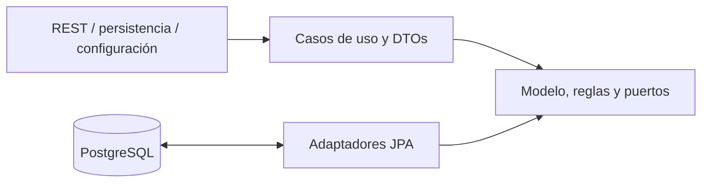
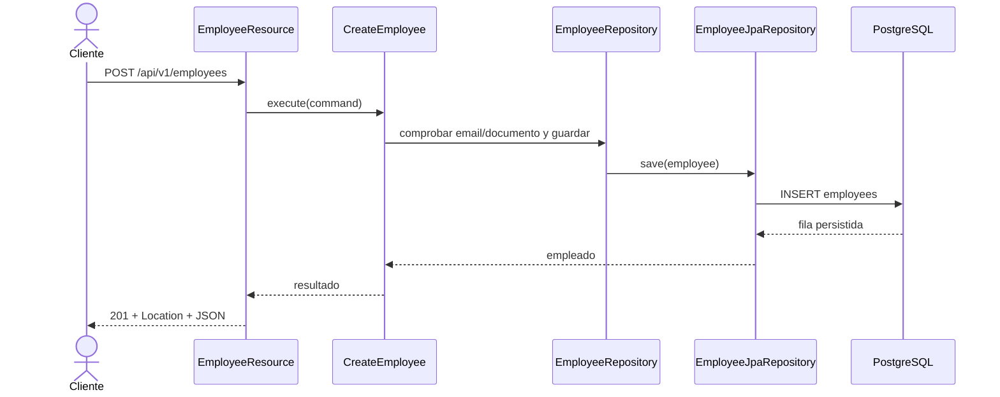
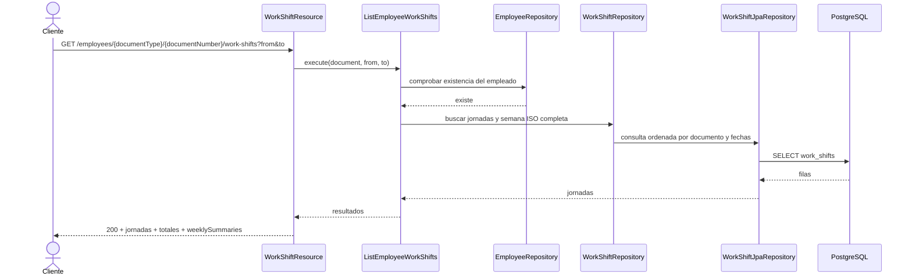
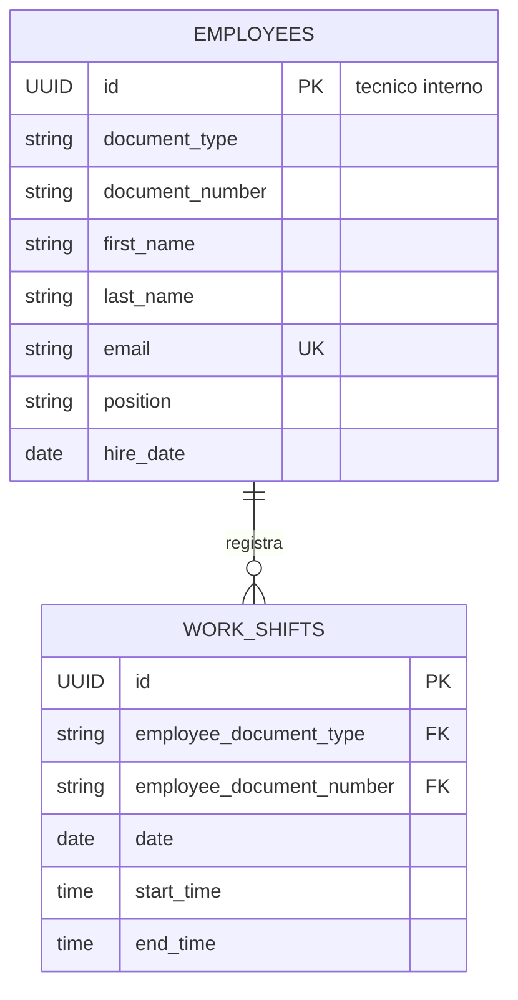

# Employees API

API REST para administrar empleados y sus jornadas laborales según reglas de Colombia. Está implementada con Java 21, Quarkus, PostgreSQL y Flyway, con separación de responsabilidades basada en Clean Architecture. No incluye interfaz web propia: Swagger UI es la interfaz interactiva de demostración.

## Requisitos y ejecución

Requisitos locales: Java 21. El Maven Wrapper incluido descarga Maven 3.9.9; desde esta carpeta ejecuta:

```powershell
.\mvnw.cmd quarkus:dev
```

Para levantar la API y PostgreSQL con Docker:

```powershell
docker compose up --build
```

Flyway crea el esquema y carga empleados y jornadas de ejemplo. URLs locales:

- Swagger UI: <http://localhost:8080/q/swagger-ui>
- OpenAPI: <http://localhost:8080/q/openapi>
- Salud: <http://localhost:8080/q/health>

En desarrollo y pruebas, Quarkus usa Dev Services por defecto. En entornos donde el cliente Docker de Dev Services no sea compatible con el daemon, se puede usar el PostgreSQL de Compose:

```powershell
docker compose up -d postgres
.\mvnw.cmd '-DTEST_DB_DEV_SERVICES=false' '-DTEST_DATASOURCE_URL=jdbc:postgresql://localhost:5432/employees_api_v2' verify
```

## Contrato REST

Prefijo: `/api/v1`. Los errores se responden como `application/problem+json`. Los POST exitosos devuelven `201 Created` y un encabezado `Location`; los DELETE exitosos devuelven `204 No Content`.

| Método | Ruta | Resultado |
|---|---|---|
| POST | `/employees` | Crea un empleado |
| GET | `/employees?page=0&size=20` | Lista empleados paginados (`size` máximo 100) |
| GET | `/employees/{documentType}/{documentNumber}` | Obtiene un empleado por documento |
| PUT | `/employees/{documentType}/{documentNumber}` | Actualiza los campos editables; documento y `hireDate` son inmutables |
| DELETE | `/employees/{documentType}/{documentNumber}` | Elimina empleado y jornadas asociadas |
| POST | `/employees/{documentType}/{documentNumber}/work-shifts` | Agrega una jornada |
| GET | `/employees/{documentType}/{documentNumber}/work-shifts` | Lista jornadas y resúmenes semanales; acepta `from` y `to` |
| GET | `/employees/{documentType}/{documentNumber}/work-shifts/{shiftId}` | Obtiene una jornada bajo su empleado |
| PUT | `/employees/{documentType}/{documentNumber}/work-shifts/{shiftId}` | Reemplaza fecha y horario de la jornada |
| DELETE | `/employees/{documentType}/{documentNumber}/work-shifts/{shiftId}` | Elimina una jornada |
| POST | `/employees/{documentType}/{documentNumber}/work-shifts/bulk` | Crea jornadas para varias fechas de forma atómica |

La identidad del empleado es `(documentType, documentNumber)`, donde el tipo es `CC`, `CE` o `PA`; el UUID de empleados es interno y no se devuelve en la API. Los números CC/CE admiten 3–20 dígitos y PA 5–20 caracteres alfanuméricos. El UUID de jornada sí es público y se utiliza como `{shiftId}`. El tipo de documento es case-insensitive y se normaliza a mayúsculas.

Las jornadas se ordenan por fecha y hora de inicio. Cada elemento incluye `workedHours`, `daytimeHours`, `nighttimeHours`, `dayType` y `shiftType`; el listado agrega totales y `weeklySummaries` para las semanas ISO completas tocadas por el filtro. Una jornada que termina antes de su hora de inicio cruza a la mañana siguiente; horas iguales se rechazan. El tiempo diurno es 06:00–21:00 y el nocturno 21:00–06:00. Domingo y festivo colombiano se clasifican por el día de inicio. El calendario calcula festivos fijos, Semana Santa y traslados de Emiliani.

Los campos de duración (`workedHours`, totales y carga semanal) se serializan como números de segundos; por ejemplo, ocho horas se devuelven como `28800`.

La carga semanal no puede superar 42 horas ISO; las horas de una jornada dominical que termina el lunes se reparten entre las dos semanas. Los solapes y excesos devuelven `409`. El bulk acepta `from`, `to`, `weekdays` opcional y una franja horaria única; un rango mayor de 92 días, `weekdays` vacío o cero fechas generadas devuelve `400`. Si alguna fecha presenta solape o exceso semanal, devuelve `409` con las fechas conflictivas y no persiste ninguna jornada. Si se omite `weekdays`, se consideran todos los días.

Los filtros `from`/`to` son opcionales e independientes; si ambos existen y `from` es posterior a `to`, la API devuelve `400`. En un empleado existente sin jornadas el GET devuelve `200` con listas vacías. Una jornada consultada bajo otro documento devuelve `404`.

No se calculan valores monetarios ni recargos, y no hay autenticación en el alcance de este ejercicio. Una jornada continua 08:00–17:00 representa nueve horas porque no se descuentan pausas; para modelar almuerzo deben registrarse dos franjas, por ejemplo 08:00–12:00 y 13:00–17:00. Cambiar un empleado de CE a CC exige una nueva alta. El documento forma parte de la URL y puede aparecer en access logs del servidor/proxy; los logs de aplicación no registran datos personales. PUT no permite corregir un documento mal digitado: se debe borrar el empleado y crearlo nuevamente.

V3 conserva los documentos alfanuméricos de datos existentes sin adivinar su tipo: convierte únicamente las semillas históricas conocidas y aborta si encuentra otras filas que no cumplen el formato numérico CC/CE. Para migrar esos datos, agrega un mapeo de tipo explícito en la propia migración después de confirmar el tipo real. Para el redespliegue de esta sesión se creó `employees_api_v2` y se aplicaron V1–V4 con datos semilla. Tras comprobar el arranque, se eliminó `employees_db` por solicitud del usuario; el volumen PostgreSQL se conservó. Si se reutiliza otra base legada, primero debe resolverse el mapeo explícito.

## Ejemplos de uso

Los comandos usan Bash y `curl`. En PowerShell puede invocarse `curl.exe`. Sustituye `SHIFT_ID` por el UUID devuelto en el POST de jornada.

```bash
BASE_URL=http://localhost:8080/api/v1
DOCUMENT_TYPE=CC
DOCUMENT_NUMBER=99887766
SHIFT_ID=REEMPLAZAR_UUID_DEVUELTO
```

### Empleados

Crear:

```bash
curl -i -X POST "$BASE_URL/employees" \
  -H 'Content-Type: application/json' \
  -d '{"documentType":"CC","documentNumber":"99887766","firstName":"Ana","lastName":"Diaz","email":"ana.diaz@example.com","position":"Analyst","hireDate":"2026-10-14"}'
```

Listar (la respuesta contiene `items`, `page`, `size` y `totalItems`):

```bash
curl "$BASE_URL/employees?page=0&size=20"
```

Consultar por documento:

```bash
curl "$BASE_URL/employees/$DOCUMENT_TYPE/$DOCUMENT_NUMBER"
```

Actualizar con reemplazo completo:

```bash
curl -i -X PUT "$BASE_URL/employees/$DOCUMENT_TYPE/$DOCUMENT_NUMBER" \
  -H 'Content-Type: application/json' \
  -d '{"firstName":"Ana","lastName":"Diaz","email":"ana.diaz@example.com","position":"Senior Analyst","hireDate":"2026-10-14"}'
```

Eliminar (también elimina sus jornadas por la FK `ON DELETE CASCADE`):

```bash
curl -i -X DELETE "$BASE_URL/employees/$DOCUMENT_TYPE/$DOCUMENT_NUMBER"
```

### Jornadas

Agregar a un empleado existente:

```bash
curl -i -X POST "$BASE_URL/employees/$DOCUMENT_TYPE/$DOCUMENT_NUMBER/work-shifts" \
  -H 'Content-Type: application/json' \
  -d '{"date":"2026-10-17","startTime":"22:00:00","endTime":"06:00:00"}'
```

Consultar el listado completo o filtrar por fechas:

```bash
curl "$BASE_URL/employees/$DOCUMENT_TYPE/$DOCUMENT_NUMBER/work-shifts"
curl "$BASE_URL/employees/$DOCUMENT_TYPE/$DOCUMENT_NUMBER/work-shifts?from=2026-10-01&to=2026-10-31"

# Carga de lunes a viernes, 4 horas por día. El campo weekdays puede omitirse
# para generar una jornada en cada fecha del rango.
curl -i -X POST "$BASE_URL/employees/$DOCUMENT_TYPE/$DOCUMENT_NUMBER/work-shifts/bulk" \
  -H 'Content-Type: application/json' \
  -d '{"from":"2026-10-19","to":"2026-10-23","weekdays":["MONDAY","TUESDAY","WEDNESDAY","THURSDAY","FRIDAY"],"startTime":"08:00:00","endTime":"12:00:00"}'
```

Consultar una jornada:

```bash
curl "$BASE_URL/employees/$DOCUMENT_TYPE/$DOCUMENT_NUMBER/work-shifts/$SHIFT_ID"
```

Actualizar:

```bash
curl -i -X PUT "$BASE_URL/employees/$DOCUMENT_TYPE/$DOCUMENT_NUMBER/work-shifts/$SHIFT_ID" \
  -H 'Content-Type: application/json' \
  -d '{"date":"2026-10-15","startTime":"08:30:00","endTime":"16:30:00"}'
```

Eliminar:

```bash
curl -i -X DELETE "$BASE_URL/employees/$DOCUMENT_TYPE/$DOCUMENT_NUMBER/work-shifts/$SHIFT_ID"

# Eliminar el empleado (y sus jornadas en cascada) al terminar la demostración.
curl -i -X DELETE "$BASE_URL/employees/$DOCUMENT_TYPE/$DOCUMENT_NUMBER"
```

## Pruebas y cobertura

Ejecutar pruebas unitarias:

```powershell
.\mvnw.cmd test
```

Ejecutar unitarias, integración y el control de cobertura:

```powershell
.\mvnw.cmd verify
```

La ejecución integral posterior a la reestructuración terminó correctamente: `verify` ejecutó **59 pruebas unitarias y 2 IT**, todas sin fallos. JaCoCo midió **95,36% de líneas unitarias (864/906)** en total; por capa: domain **92,15%**, application **97,74%** e infrastructure **96,77%**. Failsafe no instrumenta el proceso de integración, por lo que los IT no incrementan la cobertura. `EmployeeResourceIT` valida el CRUD de empleado, la creación/consulta de una jornada y que al borrar al empleado la FK en cascada elimine la jornada; además, valida la carga bulk, el resumen semanal y que un bulk conflictivo responda 409 sin persistir jornadas parciales. No hay todavía pruebas HTTP de integración para todos los once endpoints ni para todos sus errores. La suite se ejecutó contra una base aislada vacía de PostgreSQL de Compose porque Dev Services no se pudo validar por incompatibilidad con la API Docker disponible.

`docker compose config --quiet` pasó y `docker compose build app` construyó la imagen actualizada. El Compose local se redesplegó con `employees_api_v2`; Flyway quedó en V4, health respondió `200`, OpenAPI publica las once operaciones y Swagger UI carga con `200`. La nueva base contiene tres empleados y 17 jornadas semilla. Se eliminó la base anterior `employees_db` después de validar la nueva; se conservó el volumen PostgreSQL.

## Arquitectura y diseño

### Capas y dependencias



La dirección de dependencias del código apunta hacia el dominio. Los puertos de repositorio viven en `domain`; REST y persistencia los implementan o consumen desde infraestructura.

### Secuencia: crear empleado



### Secuencia: consultar jornadas



### Modelo entidad-relación



`employees` mantiene el UUID como PK técnica y una restricción `UNIQUE(document_type, document_number)`; `work_shifts` usa esa pareja como FK compuesta con `ON DELETE CASCADE`.

### Paquetes

```text
com.assessment.employees
|-- domain                         # modelo puro, excepciones y puertos
|   |-- model                      # Employee, WorkShift y value objects
|   |-- repository                 # interfaces de repositorio
|   `-- exception                  # errores de dominio
|-- application                    # orquestación sin anotaciones de framework
|   |-- dto                        # comandos y resultados
|   `-- usecase                    # una clase por intención
`-- infrastructure                # adaptadores y detalles de framework
    |-- config                     # productores CDI
    |-- persistence                # entidades JPA, mappers y repositorios
    `-- rest                       # recursos, DTOs, mappers y errores HTTP
```

Decisiones relevantes:

| Decisión | Justificación |
|---|---|
| Clean Architecture | Mantiene reglas de negocio independientes de HTTP, Quarkus y PostgreSQL. |
| Entidades JPA separadas | Evita acoplar el modelo de dominio al ORM; el mapper explícito hace visible la conversión. |
| Casos de uso sin anotaciones | La aplicación permanece Java puro; `infrastructure/config` produce los beans CDI. |
| Borrado físico | Cumple el CRUD y elimina jornadas mediante `ON DELETE CASCADE`. |
| Flyway como dueño del esquema | Versiona cambios de base de datos; Hibernate no genera tablas. |
| `application/problem+json` | Devuelve errores HTTP consistentes sin exponer SQL ni trazas. |
| Documento como identidad pública | Refleja la identificación del empleado en las rutas; el UUID queda como detalle técnico interno. |
| UUID para la jornada | Identifica una jornada de forma única, pero siempre se consulta bajo el documento dueño. |
| `hireDate` y documento inmutables | Evita que un PUT cambie la identidad o la historia laboral; corregir un documento digitado incorrectamente exige eliminar y crear el registro. |
| Clave foránea documental compuesta | Mantiene la relación de jornadas con la identidad natural del empleado y aplica cascada al borrado físico. |
| Horas semanales ISO calculadas en dominio | Centraliza el tope de 42 horas y permite repartir los turnos que atraviesan medianoche sin un endpoint de resumen adicional. |
| Carga bulk de una franja | Simplifica la carga repetitiva; todas las fechas se validan antes de guardar y el adaptador persiste la lista en una transacción. |
| Sin modelo de pausas | Para registrar almuerzo se crean dos jornadas no solapadas. Por ello, una jornada continua 08:00–17:00 contabiliza 9 horas. |
| Validación explícita de V3 | La base anterior no guardaba tipo documental. V3 convierte las tres semillas conocidas y detiene la migración ante documentos alfanuméricos restantes para que se clasifiquen explícitamente, sin inventar su tipo. |
| Dev Services con fallback configurable | Facilita pruebas automáticas cuando Docker es compatible y permite usar PostgreSQL externo cuando no lo es. |

## Uso de IA

Estas respuestas describen hechos observables de esta sesión; no pretenden describir experiencias fuera de este proyecto.

### 1. ¿Qué herramientas de IA utilizaste para desarrollar software?

En esta sesión utilicé GitHub Copilot integrado en VS Code, con el modelo GPT-6 Luna, para analizar el código, revisar problemas, proponer y aplicar correcciones, ejecutar pruebas y actualizar la documentación.

### 2. ¿Cómo verificaste que el código generado por IA sea correcto con tu propuesta de solución?

La última ejecución integral de `verify` pasó con 59 pruebas unitarias, 2 IT y el umbral JaCoCo; la cobertura unitaria medida fue 95,36% (864/906 líneas: domain 92,15%, application 97,74% e infrastructure 96,77%). `EmployeeResourceIT` comprobó contra PostgreSQL 15 el arranque de Hibernate y Flyway, las rutas documentales del empleado, la creación/consulta de una jornada, el borrado en cascada, la carga bulk, el resumen semanal y el rechazo atómico de una carga conflictiva. Durante la revisión de la base previa, V3 se detuvo de forma segura al encontrar documentos legados que requerían clasificación manual. Para el redespliegue se creó una base limpia y se eliminó la base anterior por solicitud del usuario, conservando el volumen PostgreSQL. Dev Services no se validó por incompatibilidad con la API Docker disponible. También revisé manualmente que `domain` y `application` no importen APIs de framework. La imagen redesplegada reporta health `200`, Swagger UI carga con `200` y OpenAPI publica las once operaciones.

### 3. ¿Qué riesgos ves en utilizar código generado por IA?

Puede inventar APIs o comportamientos, proponer dependencias/versiones obsoletas o vulnerables y producir código plausible que compila pero es incorrecto. También hay riesgos de fuga de datos y de incorporar código incompatible con licencias. Las pruebas y la revisión humana siguen siendo necesarias.

### 4. ¿Qué información nunca deberías enviarle a una IA?

No se deben enviar secretos, credenciales, tokens, datos personales reales, datos de clientes ni código propietario sin autorización explícita y conforme a las políticas aplicables.

### 5. ¿En qué etapas del ciclo de desarrollo utilizas IA?

En esta sesión utilicé IA durante el análisis y revisión del proyecto, la implementación de correcciones, la ejecución y ajuste de pruebas, y la actualización de la documentación. Esta respuesta describe únicamente las etapas observables en este trabajo.

### 6. ¿Qué parte de la solución generada o asistida por IA decidiste modificar o rechazar y por qué?

| Sugerencia de la IA | Decisión | Motivo |
|---|---|---|
| Usar UUID como identidad pública del empleado y añadir una ruta de cruce por documento | Rechacé esa propuesta y elegí el documento (tipo + número) como identidad en toda la API | Decidí dejar el UUID como PK técnica interna y no exponerlo en las rutas ni respuestas de empleados. |
| Crear un endpoint separado para el resumen semanal | Rechacé el endpoint nuevo; añadí `weeklySummaries` al GET de jornadas existente | Decidí mantener un contrato acotado y consultar jornadas, totales y carga semanal en una sola respuesta. |
| Permitir actualizar `hireDate` con el resto de campos | Rechacé actualizar `hireDate`; es inmutable tras la creación | Decidí conservar la fecha como dato histórico; un PUT con una fecha distinta devuelve `400`. |
| Diseñar jornadas sin las reglas laborales colombianas | Reemplacé el diseño por la clasificación de días/horas, cruce de medianoche y tope semanal de 42 horas | Decidí aterrizar el modelo a Colombia y cortar la carga por semana ISO, en lugar de limitarme a persistir franjas horarias. |
| Forzar Testcontainers/docker-java 1.20.4/3.4.0 para corregir Dev Services | Retirado tras comprobarlo | Quarkus 3.8.5 seguía cargando su cliente Docker aislado; el fallback hacia PostgreSQL de Compose pasó el IT. |
| Usar `Matchers.isEmptyOrNullString()` para verificar `Location` | Reemplazado por aserciones JUnit de presencia y contenido no blanco | El matcher estaba marcado como deprecated; las aserciones JUnit evitan la API obsoleta y verifican explícitamente el encabezado. |
| Diagnóstico inicial genérico del warning de varargs como un `thenReturn(query)` | Corregido al revisar la línea seleccionada; se encadenaron respuestas de un solo valor en los stubbings afectados | El warning real se originaba en varios valores pasados al varargs de Mockito (`Stream` y `TypedQuery`). El encadenamiento conserva las respuestas secuenciales y elimina la creación del array genérico. |