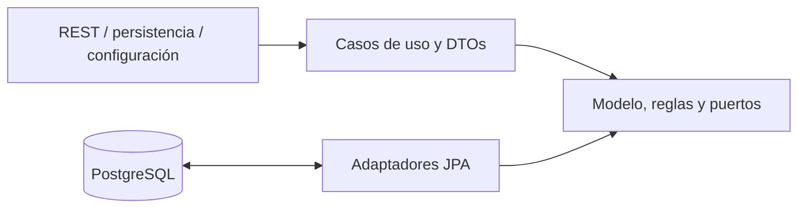
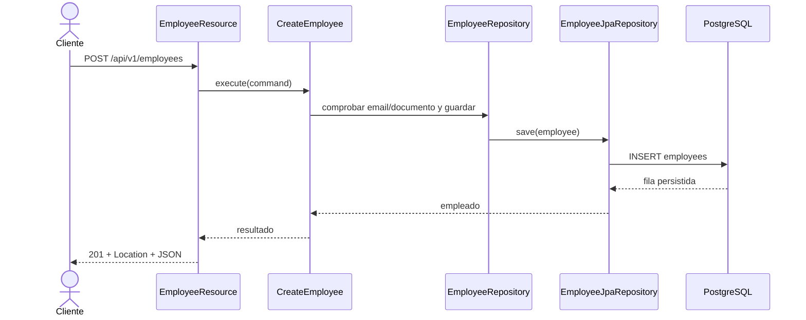
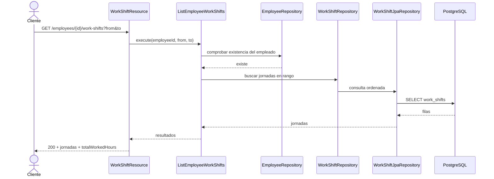
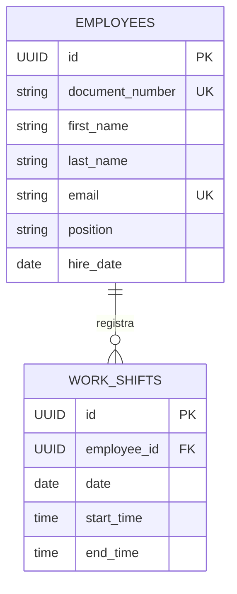

# Employees API

API REST para administrar empleados y las jornadas laborales asociadas. Está implementada con Java 21, Quarkus, PostgreSQL y Flyway, con separación de responsabilidades basada en Clean Architecture. No incluye interfaz web propia: Swagger UI es la interfaz interactiva de demostración.

## Requisitos y ejecución

Requisitos locales: Java 21. El Maven Wrapper incluido descarga Maven 3.9.9; desde esta carpeta ejecuta:

```powershell
.\mvnw.cmd quarkus:dev
```

Para levantar la API y PostgreSQL con Docker:

```powershell
docker compose up --build
```

Flyway crea el esquema y carga empleados y jornadas de ejemplo. URLs locales:

- Swagger UI: <http://localhost:8080/q/swagger-ui>
- OpenAPI: <http://localhost:8080/q/openapi>
- Salud: <http://localhost:8080/q/health>

En desarrollo y pruebas, Quarkus usa Dev Services por defecto. En entornos donde el cliente Docker de Dev Services no sea compatible con el daemon, se puede usar el PostgreSQL de Compose:

```powershell
docker compose up -d postgres
.\mvnw.cmd '-DTEST_DB_DEV_SERVICES=false' '-DTEST_DATASOURCE_URL=jdbc:postgresql://localhost:5432/employees_db' verify
```

## Contrato REST

Prefijo: `/api/v1`. Los errores se responden como `application/problem+json`. Los POST exitosos devuelven `201 Created` y un encabezado `Location`; los DELETE exitosos devuelven `204 No Content`.

| Método | Ruta | Resultado |
|---|---|---|
| POST | `/employees` | Crea un empleado |
| GET | `/employees?page=0&size=20` | Lista empleados paginados (`size` máximo 100) |
| GET | `/employees/{id}` | Obtiene un empleado |
| PUT | `/employees/{id}` | Reemplaza los datos del empleado |
| DELETE | `/employees/{id}` | Elimina empleado y jornadas asociadas |
| POST | `/employees/{employeeId}/work-shifts` | Agrega una jornada |
| GET | `/employees/{employeeId}/work-shifts` | Lista jornadas; acepta `from` y `to` (`yyyy-MM-dd`) |
| GET | `/employees/{employeeId}/work-shifts/{shiftId}` | Obtiene una jornada bajo su empleado |
| PUT | `/employees/{employeeId}/work-shifts/{shiftId}` | Reemplaza fecha y horario de la jornada |
| DELETE | `/employees/{employeeId}/work-shifts/{shiftId}` | Elimina una jornada |

Los IDs de empleados y jornadas son UUID. Las jornadas se ordenan por fecha y hora de inicio; cada elemento incluye `workedHours` y el listado agrega `totalWorkedHours`. Las fechas `from`/`to` son opcionales e independientes; si `from` es posterior a `to`, la API devuelve `400`. Una jornada solapada devuelve `409`; una jornada consultada bajo un empleado distinto devuelve `404`.

## Ejemplos de uso

Los comandos usan Bash y `curl`. En PowerShell puede invocarse `curl.exe`. En el flujo, sustituye `EMPLOYEE_ID` y `SHIFT_ID` por los UUID devueltos en las respuestas/encabezados `Location` de los POST.

```bash
BASE_URL=http://localhost:8080/api/v1
EMPLOYEE_ID=550e8400-e29b-41d4-a716-446655440001
SHIFT_ID=650e8400-e29b-41d4-a716-446655440001
```

### Empleados

Crear:

```bash
curl -i -X POST "$BASE_URL/employees" \
  -H 'Content-Type: application/json' \
  -d '{"documentNumber":"EMP900","firstName":"Ana","lastName":"Diaz","email":"ana.diaz@example.com","position":"Analyst","hireDate":"2026-10-14"}'
```

Listar (la respuesta contiene `items`, `page`, `size` y `totalItems`):

```bash
curl "$BASE_URL/employees?page=0&size=20"
```

Consultar por UUID:

```bash
curl "$BASE_URL/employees/$EMPLOYEE_ID"
```

Actualizar con reemplazo completo:

```bash
curl -i -X PUT "$BASE_URL/employees/$EMPLOYEE_ID" \
  -H 'Content-Type: application/json' \
  -d '{"documentNumber":"EMP900","firstName":"Ana","lastName":"Diaz","email":"ana.diaz@example.com","position":"Senior Analyst","hireDate":"2026-10-14"}'
```

Eliminar (también elimina sus jornadas por la FK `ON DELETE CASCADE`):

```bash
curl -i -X DELETE "$BASE_URL/employees/$EMPLOYEE_ID"
```

### Jornadas

Agregar a un empleado existente:

```bash
curl -i -X POST "$BASE_URL/employees/$EMPLOYEE_ID/work-shifts" \
  -H 'Content-Type: application/json' \
  -d '{"date":"2026-10-15","startTime":"09:00:00","endTime":"17:00:00"}'
```

Consultar el listado completo o filtrar por fechas:

```bash
curl "$BASE_URL/employees/$EMPLOYEE_ID/work-shifts"
curl "$BASE_URL/employees/$EMPLOYEE_ID/work-shifts?from=2026-10-01&to=2026-10-31"
```

Consultar una jornada:

```bash
curl "$BASE_URL/employees/$EMPLOYEE_ID/work-shifts/$SHIFT_ID"
```

Actualizar:

```bash
curl -i -X PUT "$BASE_URL/employees/$EMPLOYEE_ID/work-shifts/$SHIFT_ID" \
  -H 'Content-Type: application/json' \
  -d '{"date":"2026-10-15","startTime":"08:30:00","endTime":"16:30:00"}'
```

Eliminar:

```bash
curl -i -X DELETE "$BASE_URL/employees/$EMPLOYEE_ID/work-shifts/$SHIFT_ID"
```

## Pruebas y cobertura

Ejecutar pruebas unitarias:

```powershell
.\mvnw.cmd test
```

Ejecutar unitarias, integración y el control de cobertura:

```powershell
.\mvnw.cmd verify
```

La última ejecución de `verify` terminó correctamente: 39 pruebas unitarias y 1 prueba de integración, todas sin fallos; JaCoCo midió **96,82% de líneas unitarias (608 cubiertas de 628)**. Failsafe no instrumenta el proceso de integración, así que el IT no infla la cobertura. `EmployeeResourceIT` usó PostgreSQL 15 de Compose y verificó Flyway, Hibernate y el ciclo de creación, lectura, listado y borrado. En el entorno validado se seleccionó el fallback externo porque el Docker Desktop disponible requiere API 1.40 y el cliente aislado de Dev Services de Quarkus 3.8.5 solicita API 1.32.

También se construyó y levantó la imagen con Docker Compose. Health, OpenAPI y Swagger UI respondieron `200`; la especificación publicada contiene las 10 operaciones, sus resúmenes y ejemplos de campos de entrada.

## Arquitectura y diseño

### Capas y dependencias



La dirección de dependencias del código apunta hacia el dominio. Los puertos de repositorio viven en `domain`; REST y persistencia los implementan o consumen desde infraestructura.

### Secuencia: crear empleado



### Secuencia: consultar jornadas



### Modelo entidad-relación



### Paquetes

```text
com.assessment.employees
|-- domain                         # modelo puro, excepciones y puertos
|   |-- model                      # Employee, WorkShift y value objects
|   |-- repository                 # interfaces de repositorio
|   `-- exception                  # errores de dominio
|-- application                    # orquestación sin anotaciones de framework
|   |-- dto                        # comandos y resultados
|   `-- usecase                    # una clase por intención
`-- infrastructure                # adaptadores y detalles de framework
    |-- config                     # productores CDI
    |-- persistence                # entidades JPA, mappers y repositorios
    `-- rest                       # recursos, DTOs, mappers y errores HTTP
```

Decisiones relevantes:

| Decisión | Justificación |
|---|---|
| Clean Architecture | Mantiene reglas de negocio independientes de HTTP, Quarkus y PostgreSQL. |
| Entidades JPA separadas | Evita acoplar el modelo de dominio al ORM; el mapper explícito hace visible la conversión. |
| Casos de uso sin anotaciones | La aplicación permanece Java puro; `infrastructure/config` produce los beans CDI. |
| Borrado físico | Cumple el CRUD y elimina jornadas mediante `ON DELETE CASCADE`. |
| Flyway como dueño del esquema | Versiona cambios de base de datos; Hibernate no genera tablas. |
| `application/problem+json` | Devuelve errores HTTP consistentes sin exponer SQL ni trazas. |
| UUID para empleado y jornada | Mantiene tipos coherentes entre el dominio, JPA, rutas y PostgreSQL. |
| Dev Services con fallback configurable | Facilita pruebas automáticas cuando Docker es compatible y permite usar PostgreSQL externo cuando no lo es. |

## Uso de IA

Estas respuestas describen hechos observables de esta sesión; no pretenden describir experiencias fuera de este proyecto.

### 1. ¿Qué herramientas de IA utilizaste para desarrollar software?

En esta sesión utilicé GitHub Copilot integrado en VS Code, con el modelo GPT-6 Luna, para analizar el código, revisar problemas, proponer y aplicar correcciones, ejecutar pruebas y actualizar la documentación.

### 2. ¿Cómo verificaste que el código generado por IA sea correcto con tu propuesta de solución?

La última ejecución integral registrada de `verify` pasó con 39 pruebas unitarias, 1 prueba de integración y el umbral JaCoCo configurado; la cobertura unitaria medida fue 96,82% (608/628 líneas). `EmployeeResourceIT` comprobó contra PostgreSQL 15 el arranque de Hibernate, Flyway y el flujo de crear, obtener, listar y eliminar un empleado. El IT se ejecutó con PostgreSQL de Compose porque Dev Services presentó una incompatibilidad con la API Docker disponible; por ello no afirmo que Dev Services haya pasado. La imagen Docker se construyó y health, OpenAPI y Swagger UI devolvieron `200`. También revisé manualmente que `domain` y `application` no importen APIs de framework. Tras esa ejecución integral se corrigieron avisos de tipos en stubbings Mockito y una aserción obsoleta: las dos clases de repositorio afectadas pasaron individualmente; `EmployeeResourceIT` se recompiló correctamente. Aún debe repetirse `verify` para validar el estado final completo.

### 3. ¿Qué riesgos ves en utilizar código generado por IA?

Puede inventar APIs o comportamientos, proponer dependencias/versiones obsoletas o vulnerables y producir código plausible que compila pero es incorrecto. También hay riesgos de fuga de datos y de incorporar código incompatible con licencias. Las pruebas y la revisión humana siguen siendo necesarias.

### 4. ¿Qué información nunca deberías enviarle a una IA?

No se deben enviar secretos, credenciales, tokens, datos personales reales, datos de clientes ni código propietario sin autorización explícita y conforme a las políticas aplicables.

### 5. ¿En qué etapas del ciclo de desarrollo utilizas IA?

En esta sesión utilicé IA durante el análisis y revisión del proyecto, la implementación de correcciones, la ejecución y ajuste de pruebas, y la actualización de la documentación. Esta respuesta describe únicamente las etapas observables en este trabajo.

### 6. ¿Qué parte de la solución generada o asistida por IA decidiste modificar o rechazar y por qué?

| Sugerencia de la IA | Decisión | Motivo |
|---|---|---|
| Mantener `employeeId` como texto dentro de la entidad JPA | Modificada durante la corrección asistida: ahora es UUID | PostgreSQL define `work_shifts.employee_id` como UUID; usar texto provocaba `uuid = character varying` al borrar jornadas. |
| Forzar Testcontainers/docker-java 1.20.4/3.4.0 para corregir Dev Services | Retirado tras comprobarlo | Quarkus 3.8.5 seguía cargando su cliente Docker aislado; el fallback hacia PostgreSQL de Compose pasó el IT. |
| Usar `Matchers.isEmptyOrNullString()` para verificar `Location` | Reemplazado por aserciones JUnit de presencia y contenido no blanco | El matcher estaba marcado como deprecated; las aserciones JUnit evitan la API obsoleta y verifican explícitamente el encabezado. |
| Diagnóstico inicial genérico del warning de varargs como un `thenReturn(query)` | Corregido al revisar la línea seleccionada; se encadenaron respuestas de un solo valor en los stubbings afectados | El warning real se originaba en varios valores pasados al varargs de Mockito (`Stream` y `TypedQuery`). El encadenamiento conserva las respuestas secuenciales y elimina la creación del array genérico. |