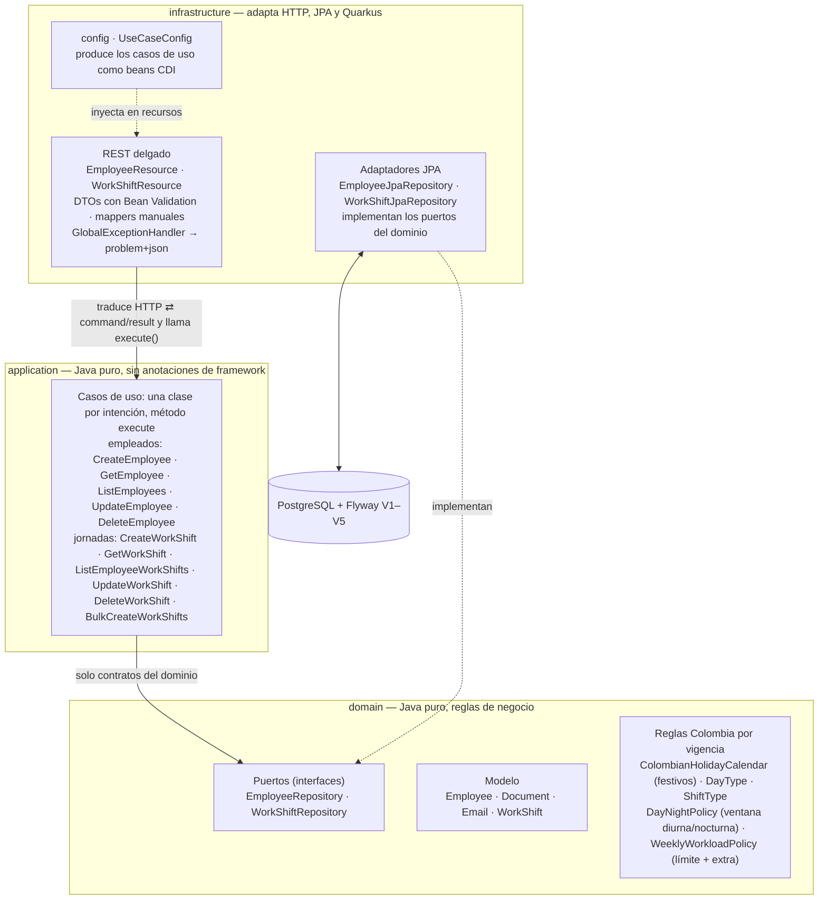
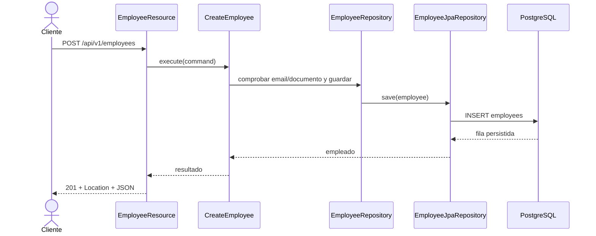
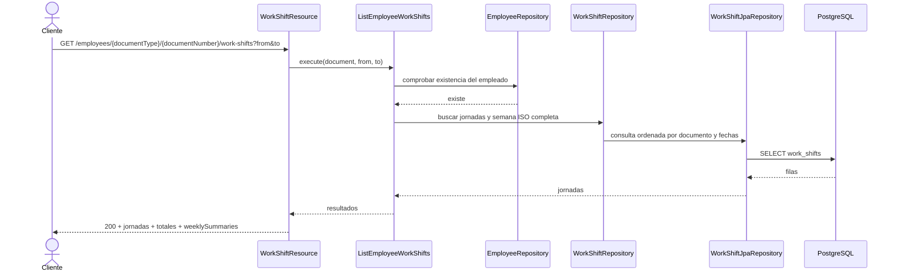
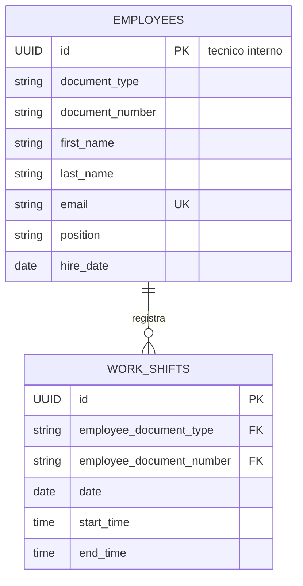

# Employees API

API REST para administrar empleados y sus jornadas laborales según reglas de Colombia. Está implementada con Java 21, Quarkus, PostgreSQL y Flyway, con separación de responsabilidades basada en Clean Architecture. No incluye interfaz web propia: Swagger UI es la interfaz interactiva de demostración.

## Requisitos y ejecución

Requisitos locales: Java 21. El Maven Wrapper incluido descarga Maven 3.9.9; desde esta carpeta ejecuta:

```powershell
.\mvnw.cmd quarkus:dev
```

Para levantar la API y PostgreSQL con Docker:

```powershell
docker compose up --build
```

Flyway crea el esquema y carga empleados y jornadas de ejemplo. URLs locales:

- Swagger UI: <http://localhost:8080/q/swagger-ui>
- OpenAPI: <http://localhost:8080/q/openapi>
- Salud: <http://localhost:8080/q/health>

En desarrollo y pruebas, Quarkus usa Dev Services por defecto. En entornos donde el cliente Docker de Dev Services no sea compatible con el daemon, se puede usar el PostgreSQL de Compose:

```powershell
docker compose up -d postgres
.\mvnw.cmd '-DTEST_DB_DEV_SERVICES=false' '-DTEST_DATASOURCE_URL=jdbc:postgresql://localhost:5432/employees_api_v2' verify
```

## Contrato REST

Prefijo: `/api/v1`. Los errores se responden como `application/problem+json`. Los POST exitosos devuelven `201 Created` y un encabezado `Location`; los DELETE exitosos devuelven `204 No Content`.

| Método | Ruta | Resultado |
|---|---|---|
| POST | `/employees` | Crea un empleado |
| GET | `/employees?page=0&size=20` | Lista empleados paginados (`size` máximo 100) |
| GET | `/employees/{documentType}/{documentNumber}` | Obtiene un empleado por documento |
| PUT | `/employees/{documentType}/{documentNumber}` | Actualización parcial: solo los campos enviados se actualizan; documento y `hireDate` inmutables |
| DELETE | `/employees/{documentType}/{documentNumber}` | Elimina empleado y jornadas asociadas |
| POST | `/employees/{documentType}/{documentNumber}/work-shifts` | Agrega una jornada |
| GET | `/employees/{documentType}/{documentNumber}/work-shifts` | Lista jornadas y resúmenes semanales; acepta `from` y `to` |
| GET | `/employees/{documentType}/{documentNumber}/work-shifts/{shiftId}` | Obtiene una jornada bajo su empleado |
| PUT | `/employees/{documentType}/{documentNumber}/work-shifts/{shiftId}` | Reemplaza fecha y horario de la jornada |
| DELETE | `/employees/{documentType}/{documentNumber}/work-shifts/{shiftId}` | Elimina una jornada |
| POST | `/employees/{documentType}/{documentNumber}/work-shifts/bulk` | Crea jornadas para varias fechas de forma atómica |

La identidad del empleado es `(documentType, documentNumber)`, donde el tipo es `CC`, `CE` o `PA`; el UUID de empleados es interno y no se devuelve en la API. Los números CC/CE admiten 3–20 dígitos y PA 5–20 caracteres alfanuméricos. El UUID de jornada sí es público y se utiliza como `{shiftId}`. El tipo de documento es case-insensitive y se normaliza a mayúsculas.

Las jornadas se ordenan por fecha y hora de inicio. Cada elemento incluye `date`, `startTime` y `endTime` (formato `HH:mm`; un `endTime` menor que el inicio cruza a la mañana siguiente, horas iguales se rechazan), `dayType`, `shiftType` y las horas decimales `workedHours`, `daytimeHours` y `nighttimeHours` (sin pausas: una jornada continua 08:00–17:00 cuenta nueve horas). El desglose diurno/nocturno y el tipo de turno se calculan con la ventana vigente en la **fecha de inicio** de la jornada. Domingo y festivo colombiano se clasifican por el día de inicio. El calendario calcula festivos fijos, Semana Santa y traslados de Emiliani. El listado agrega `totalWorkedHours` (suma exacta de las jornadas listadas) y `weeklySummaries` para las semanas ISO completas tocadas por el filtro.

El proyecto aplica los parámetros legales colombianos **por vigencia** (no constituye asesoría legal; las reglas se validaron solo como aproximación técnica de este ejercicio):

| Vigente desde | Límite ordinario semanal | Ventana diurna | Ventana nocturna |
|---|---|---|---|
| antes del 2023-07-15 | 48 h | — | — |
| 2023-07-15 (Ley 2101 de 2021) | 47 h | 06:00–21:00 | 21:00–06:00 |
| 2024-07-15 | 46 h | idem | idem |
| 2025-07-15 | 44 h | idem | idem |
| 2026-07-15 | **42 h** | idem | idem |
| 2025-12-25 (Ley 2466 de 2025, art. 10) | — | **06:00–19:00** | **19:00–06:00** |

Criterios de aplicación: el límite de una semana ISO es el vigente en su **domingo** (criterio conservador en semanas de transición) y la ventana diurna/nocturna de una jornada es la vigente en su **fecha de inicio**, incluso si cruza medianoche. Fuentes: Ley 2101 de 2021 (reducción gradual de la jornada máxima ordinaria), Ley 2466 de 2025 art. 10 (ventana nocturna) y art. 22 de la Ley 50 de 1990 modificado por la misma ley (horas extra). Fuera de alcance: tope diario de 2 h extra, regímenes especiales (vigilancia, Ley 1920 de 2018, salud), distribuciones flexibles de jornada, tiempo parcial y todo cálculo monetario.

Las duraciones se reportan en **horas decimales con dos decimales** (`HALF_UP`); ocho horas se devuelven como `8.00` y 450 minutos como `7.50`.

Por semana ISO: `scheduledHours` suma toda la semana (aunque el filtro la corte), `overtimeHours` es el exceso sobre el límite ordinario vigente y `remainingOrdinaryHours` las horas ordinarias restantes. El exceso programado **no se rechaza**: se informa como horas extra y solo devuelve `409` cuando las extra de la semana superan **12 horas** (`WeeklyHoursExceededException`). Las jornadas que terminan el lunes se reparten entre las dos semanas ISO. Los solapes, incluso cruzando medianoche, devuelven `409`. El bulk acepta `from`, `to`, `weekdays` opcional y una franja horaria única; un rango mayor de 92 días, `weekdays` vacío o cero fechas generadas devuelve `400`. Si alguna fecha presenta solape o exceso del tope de extra, devuelve `409` con las fechas conflictivas y no persiste ninguna jornada. Si se omite `weekdays`, se consideran todos los días. La semilla realista incluye la semana 2026-W42 del empleado `CC/10000001` con **46 h programadas → 4 h extra** (`V5__overtime_seed_data.sql`), visible desde el primer arranque.

Los filtros `from`/`to` son opcionales e independientes; si ambos existen y `from` es posterior a `to`, la API devuelve `400`. En un empleado existente sin jornadas el GET devuelve `200` con listas vacías. Una jornada consultada bajo otro documento devuelve `404`.

Precisión de los errores `problem+json`: la paginación inválida (`page` negativo, `size` fuera de 1–100 o desbordamiento al multiplicar) devuelve `400` mediante `InvalidPaginationException`. Los `409` conservan el detalle del dominio en el `detail`: el duplicado de empleado indica si el conflicto es por **correo** o por **documento** (`DuplicateEmployeeException`), el solape reporta fecha y franja en conflicto (`WorkShiftOverlapException`), el tope semanal describe la semana, horas programadas y máximo permitido (`WeeklyHoursExceededException`) y el conflicto del bulk lista las fechas conflictivas sin crear nada (`WorkShiftBulkConflictException`). El título `problem+json` es el de la categoría de respuesta (`No encontrado`, `Conflicto`, `Solicitud inválida`, `Error de validación`), no un rótulo fijo para todo 400. `Email` y los demás invariantes del dominio devuelven sus mensajes en español.

No se calculan valores monetarios ni recargos, y no hay autenticación en el alcance de este ejercicio. Una jornada continua 08:00–17:00 representa nueve horas porque no se descuentan pausas; para modelar almuerzo deben registrarse dos franjas, por ejemplo 08:00–12:00 y 13:00–17:00. Cambiar un empleado de CE a CC exige una nueva alta. El documento forma parte de la URL y puede aparecer en access logs del servidor/proxy; los logs de aplicación no registran datos personales. PUT no permite corregir un documento mal digitado: se debe borrar el empleado y crearlo nuevamente.

V3 conserva los documentos alfanuméricos de datos existentes sin adivinar su tipo: convierte únicamente las semillas históricas conocidas y aborta si encuentra otras filas que no cumplen el formato numérico CC/CE. Para migrar esos datos, agrega un mapeo de tipo explícito en la propia migración después de confirmar el tipo real. Para el redespliegue de esta sesión se creó `employees_api_v2` y se aplicaron V1–V4 con datos semilla. Tras comprobar el arranque, se eliminó `employees_db` por solicitud del usuario; el volumen PostgreSQL se conservó. Si se reutiliza otra base legada, primero debe resolverse el mapeo explícito.

## Ejemplos de uso

Los comandos usan Bash y `curl`. En PowerShell puede invocarse `curl.exe`. Sustituye `SHIFT_ID` por el UUID devuelto en el POST de jornada.

```bash
BASE_URL=http://localhost:8080/api/v1
DOCUMENT_TYPE=CC
DOCUMENT_NUMBER=99887766
SHIFT_ID=REEMPLAZAR_UUID_DEVUELTO
```

### Empleados

Crear:

```bash
curl -i -X POST "$BASE_URL/employees" \
  -H 'Content-Type: application/json' \
  -d '{"documentType":"CC","documentNumber":"99887766","firstName":"Ana","lastName":"Diaz","email":"ana.diaz@example.com","position":"Analyst","hireDate":"2026-10-14"}'
```

Listar (la respuesta contiene `items`, `page`, `size` y `totalItems`):

```bash
curl "$BASE_URL/employees?page=0&size=20"
```

Consultar por documento:

```bash
curl "$BASE_URL/employees/$DOCUMENT_TYPE/$DOCUMENT_NUMBER"
```

Actualizar (parcial): solo los campos enviados se actualizan; los omitidos conservan su valor. Si se envía `hireDate`, debe coincidir con la actual (no es modificable); un body sin ningún campo devuelve `400`:

```bash
curl -i -X PUT "$BASE_URL/employees/$DOCUMENT_TYPE/$DOCUMENT_NUMBER" \
  -H 'Content-Type: application/json' \
  -d '{"position":"Senior Analyst"}'

# También se acepta el body completo (equivalente a una actualización con todos los campos):
curl -i -X PUT "$BASE_URL/employees/$DOCUMENT_TYPE/$DOCUMENT_NUMBER" \
  -H 'Content-Type: application/json' \
  -d '{"firstName":"Ana","lastName":"Diaz","email":"ana.diaz@example.com","position":"Senior Analyst","hireDate":"2026-10-14"}'
```

Eliminar (también elimina sus jornadas por la FK `ON DELETE CASCADE`):

```bash
curl -i -X DELETE "$BASE_URL/employees/$DOCUMENT_TYPE/$DOCUMENT_NUMBER"
```

### Jornadas

Agregar a un empleado existente:

```bash
curl -i -X POST "$BASE_URL/employees/$DOCUMENT_TYPE/$DOCUMENT_NUMBER/work-shifts" \
  -H 'Content-Type: application/json' \
  -d '{"date":"2026-10-17","startTime":"22:00","endTime":"06:00"}'
```

Consultar el listado completo o filtrar por fechas:

```bash
curl "$BASE_URL/employees/$DOCUMENT_TYPE/$DOCUMENT_NUMBER/work-shifts"
curl "$BASE_URL/employees/$DOCUMENT_TYPE/$DOCUMENT_NUMBER/work-shifts?from=2026-10-01&to=2026-10-31"

# Carga de lunes a viernes, 4 horas por día. El campo weekdays puede omitirse
# para generar una jornada en cada fecha del rango.
curl -i -X POST "$BASE_URL/employees/$DOCUMENT_TYPE/$DOCUMENT_NUMBER/work-shifts/bulk" \
  -H 'Content-Type: application/json' \
  -d '{"from":"2026-10-19","to":"2026-10-23","weekdays":["MONDAY","TUESDAY","WEDNESDAY","THURSDAY","FRIDAY"],"startTime":"08:00","endTime":"12:00"}'
```

Ejemplo de resumen semanal (semana 2026-W42 del empleado semilla `CC/10000001`, con 46 h programadas):

```json
{
  "shifts": [
    {
      "id": "750e8400-e29b-41d4-a716-446655440013",
      "date": "2026-10-17",
      "startTime": "06:00",
      "endTime": "12:00",
      "dayType": "ORDINARIO",
      "shiftType": "DIURNA",
      "workedHours": 6.00,
      "daytimeHours": 6.00,
      "nighttimeHours": 0.00
    }
  ],
  "totalWorkedHours": 46.00,
  "weeklySummaries": [
    {
      "week": "2026-W42",
      "startDate": "2026-10-12",
      "endDate": "2026-10-18",
      "scheduledHours": 46.00,
      "ordinaryLimitHours": 42.00,
      "overtimeHours": 4.00,
      "remainingOrdinaryHours": 0.00
    }
  ]
}
```

Consultar una jornada:

```bash
curl "$BASE_URL/employees/$DOCUMENT_TYPE/$DOCUMENT_NUMBER/work-shifts/$SHIFT_ID"
```

Actualizar:

```bash
curl -i -X PUT "$BASE_URL/employees/$DOCUMENT_TYPE/$DOCUMENT_NUMBER/work-shifts/$SHIFT_ID" \
  -H 'Content-Type: application/json' \
  -d '{"date":"2026-10-15","startTime":"08:30","endTime":"16:30"}'
```

Eliminar:

```bash
curl -i -X DELETE "$BASE_URL/employees/$DOCUMENT_TYPE/$DOCUMENT_NUMBER/work-shifts/$SHIFT_ID"

# Eliminar el empleado (y sus jornadas en cascada) al terminar la demostración.
curl -i -X DELETE "$BASE_URL/employees/$DOCUMENT_TYPE/$DOCUMENT_NUMBER"
```

## Pruebas y cobertura

Ejecutar pruebas unitarias:

```powershell
.\mvnw.cmd test
```

Ejecutar unitarias, integración y el control de cobertura:

```powershell
.\mvnw.cmd verify
```

La última ejecución integral (`verify`, 2026-10-17, tras la ronda de cobertura HTTP de los once endpoints) terminó en verde: **75 pruebas unitarias y 10 IT**, todas sin fallos, y JaCoCo verificó el umbral de 80 % (`All coverage checks have been met`). JaCoCo midió **97,24 % de líneas unitarias (880/905)**; por capa: domain **95,43 %** (313/328), application **98,83 %** (253/256) e infrastructure **97,82 %** (314/321). Failsafe no instrumenta el proceso de integración, por lo que los IT no incrementan la cifra medida. Las pruebas unitarias recientes cubren los mensajes exactos de `Email`, la paginación (`InvalidPaginationException` con el tope `size` > 100 y el desbordamiento de página), la conservación del detalle en los 409 de duplicado/solape y el título `Solicitud inválida`; además cubren las vigencias del límite ordinario (47 h en 2024-W28 y 46 h en 2024-W29; 44 h en 2025-W29; 42 h en 2026-W29 y 2026-W42), el tope de horas extra (46 h reportan 4 extra y pasan; 55 h devuelven 409; 54 h exactas pasan), la ventana diurna/nocturna por fecha (18:00–22:00 deja 1 h nocturna el 2025-12-24 y 3 h el 2025-12-25; la ventana de la fecha de inicio aplica en turnos que cruzan medianoche) y el PUT parcial de empleados. Integración: `EmployeeResourceIT` (6 IT) cubre el CRUD de empleado, la creación/consulta de jornadas con horas decimales y `HH:mm`, la cascada al borrar al empleado, la carga bulk, el resumen semanal, los 400/409 de creación y los duplicados de documento y correo por separado, la paginación y sus 400, y los errores 400/404/409 de GET/PUT/DELETE; `WorkShiftResourceIT` (4 IT) cubre los seis endpoints de jornadas con sus errores: franja de 0 h (400), empleado inexistente (404), solape (409), listado ordenado por fecha con filtros `from`/`to` (400 si `from > to`, 404 con empleado inexistente), GET/PUT/DELETE de una jornada (404 ajeno e inexistente, 204 y 404 tras borrar) y bulk (400 por rango invertido, rango mayor a 92 días, `weekdays` vacío o cero jornadas generadas; empleado inexistente 404). La suite corrió contra PostgreSQL de Compose (`employees_api_v2`, Flyway en V5); Dev Services no se pudo validar por incompatibilidad del cliente Docker del entorno.

`docker compose config --quiet` pasó y `docker compose build app` construyó la imagen actualizada. El Compose local se redesplegó con `employees_api_v2`; Flyway quedó en **V5** (semilla de horas extra), health respondió `200`, OpenAPI publica las once operaciones y Swagger UI carga con `200`. La base contiene tres empleados y 18 jornadas semilla (la semana 2026-W42 con 46 h → 4 h extra). Se conserva el volumen PostgreSQL entre redespliegues; al terminar la demostración, ejecuta `docker compose down` sin borrarlo.

## Arquitectura y diseño

### Capas y dependencias



La dirección de dependencias del código apunta hacia el dominio: `application` solo conoce los puertos (`domain`); es la persistencia quien los implementa (flecha discontinua = inversión de dependencias). `UseCaseConfig` registra los casos de uso como beans CDI para que `application` permanezca libre de anotaciones; la asignación por constructor permite probar cada clase con Mockito sin Quarkus.

### Secuencia: crear empleado



### Secuencia: consultar jornadas



### Modelo entidad-relación



`employees` mantiene el UUID como PK técnica y una restricción `UNIQUE(document_type, document_number)`; `work_shifts` usa esa pareja como FK compuesta con `ON DELETE CASCADE`.

### Paquetes

```text
com.assessment.employees
|-- domain                          # Java puro: reglas, contratos y excepciones
|   |-- model                       # Employee, Document, Email, WorkShift
|   |                               #   + reglas Colombia: ColombianHolidayCalendar,
|   |                               #   DayType/ShiftType, DayNightPolicy y
|   |                               #   WeeklyWorkloadPolicy (vigencias legales)
|   |-- repository                  # puertos: EmployeeRepository, WorkShiftRepository
|   `-- exception                   # excepciones de dominio (sin HTTP)
|-- application                     # orquestación sin anotaciones de framework
|   |-- dto                         # comandos y resultados (records)
|   `-- usecase                     # una clase por intención (método execute)
`-- infrastructure                  # detalles de framework
    |-- config                      # UseCaseConfig: productores CDI de casos de uso
    |-- persistence                 # entidades JPA, mappers y adaptadores de puertos
    `-- rest                        # resources, DTOs, mappers, GlobalExceptionHandler
```

Decisiones relevantes:

| Decisión | Justificación |
|---|---|
| Clean Architecture | Mantiene reglas de negocio independientes de HTTP, Quarkus y PostgreSQL. |
| Entidades JPA separadas | Evita acoplar el modelo de dominio al ORM; el mapper explícito hace visible la conversión. |
| Casos de uso sin anotaciones | La aplicación permanece Java puro; `infrastructure/config` produce los beans CDI. |
| Borrado físico | Cumple el CRUD y elimina jornadas mediante `ON DELETE CASCADE`. |
| Flyway como dueño del esquema | Versiona cambios de base de datos; Hibernate no genera tablas. |
| `application/problem+json` | Devuelve errores HTTP consistentes sin exponer SQL ni trazas. |
| Documento como identidad pública | Refleja la identificación del empleado en las rutas; el UUID queda como detalle técnico interno. |
| UUID para la jornada | Identifica una jornada de forma única, pero siempre se consulta bajo el documento dueño. |
| `hireDate` y documento inmutables | Evita que un PUT cambie la identidad o la historia laboral; corregir un documento digitado incorrectamente exige eliminar y crear el registro. |
| PUT de empleados como actualización parcial | Solo los campos enviados (`firstName`, `lastName`, `email`, `position`) se actualizan y validan; los omitidos conservan su valor y debe llegar al menos un campo (400 en caso contrario). Simplifica el uso del endpoint sin debilitar las invariantes del dominio. |
| Clave foránea documental compuesta | Mantiene la relación de jornadas con la identidad natural del empleado y aplica cascada al borrado físico. |
| Horas semanales ISO calculadas en dominio | Centraliza el criterio semanal y permite repartir los turnos que atraviesan medianoche sin un endpoint de resumen adicional. |
| Parámetros legales por vigencia (`WeeklyWorkloadPolicy`, `DayNightPolicy`) | El límite ordinario (48/47/46/44/42 h, Ley 2101 de 2021) y la ventana diurna/nocturna (Ley 2466 de 2025) cambian con el tiempo; se representan como tablas de vigencias inmutables y no como constantes únicas, y se corrijen en el dominio con Java puro. |
| Horas extra informadas, no bloqueadas | Superar el límite ordinario se reporta en `overtimeHours`; solo se rechaza (409) al superar 12 h extra semanales (art. 22, Ley 50 de 1990, modificado por la Ley 2466 de 2025). Supuestos por defecto: no se valida el tope diario de 2 h extra. |
| Horas decimales y `HH:mm` en la respuesta | Las duraciones de dominio (`Duration`) se convierten a horas decimales de 2 decimales al serializar; evita segundos crudos (`28800`) y facilita la lectura en Swagger UI. |
| Carga bulk de una franja | Simplifica la carga repetitiva; todas las fechas se validan antes de guardar y el adaptador persiste la lista en una transacción. |
| Sin modelo de pausas | Para registrar almuerzo se crean dos jornadas no solapadas. Por ello, una jornada continua 08:00–17:00 contabiliza 9 horas. |
| Validación explícita de V3 | La base anterior no guardaba tipo documental. V3 convierte las tres semillas conocidas y detiene la migración ante documentos alfanuméricos restantes para que se clasifiquen explícitamente, sin inventar su tipo. |
| Dev Services con fallback configurable | Facilita pruebas automáticas cuando Docker es compatible y permite usar PostgreSQL externo cuando no lo es. |
| `WorkShift` inmutable con `with(...)` | Las jornadas se modifican generando una nueva instancia validada en su constructor, en lugar de mutar campos internos con `update(...)`. Reduce el riesgo de estados parciales y facilita calcular solapes con el objeto candidato. |
| `Clock` inyectado para reglas con fecha actual | La validación de `hireDate` no futura dependía de `LocalDate.now()` dentro del dominio (no determinista y difícil de probar). `CreateEmployee` recibe un `Clock` (producido en `UseCaseConfig`) y los tests usan relojes fijos; la reconstitución desde JPA no repite la verificación (ya validada al escribir). |
| Tipos de `java.time` en el dominio | Los envoltorios `Date`/`Time` se eliminaron: sombreaban a los tipos estándar sin aportar validaciones y obligaban a conversiones de ida y vuelta en `WorkShift`. |
| Guardas compartidas de jornada en el dominio | `WorkShift.rejectOverlap(...)` y `WorkShift.weekStartOf(...)` centralizan la validación de solape y el corte de semana ISO que antes duplicaban `CreateWorkShift`, `UpdateWorkShift`, `BulkCreateWorkShifts` y `ListEmployeeWorkShifts`. |
| Commands de aplicación con `Document` | Los DTOs de comandos cargan la identidad ya validada del dominio en lugar del par `(documentType, documentNumber)` de strings; se elimina la validación repetida en cada caso de uso y el riesgo de órdenes distintas de los parámetros. |
| REST delgado sin lógica de presentación | `totalWorkedHours` se calcula en el resultado de aplicación, y el formato de semana ISO (`2026-W42`), el parseo de fechas y la conversión de horas viven en el mapper REST; `WorkShiftResponse` reporta `dayType`/`shiftType` como `String`, desacoplado del enum del dominio. |
| Puertos sin código muerto | Se eliminaron métodos sin uso y defaults peligrosos de `EmployeeRepository`; la única implementación (`EmployeeJpaRepository`) define el resto del papel del puerto. |
| Error contract estricto (`problem+json` sin `timestamp`) | La respuesta de error solo contiene los campos del RFC 7807 (`type`, `title`, `status`, `detail`, `instance`, y `errors` en validaciones); el `timestamp` adicional se retiró y los campos nulos no se serializan (`@JsonInclude(NON_NULL)`). |
| Detalle fiable en cada error | El `detail` viaja tal como lo produce el dominio: el 409 de duplicado discrimina correo/documento, el 409 de solape reporta fecha y franja, y el título responde a la categoría de la respuesta (un `400` genérico se titula "Solicitud inválida", no "Error de validación"). Los invariantes de `Email`/`EmployeeId` emiten mensajes en español. |
| Paginación como excepción de dominio | `InvalidPaginationException` reemplaza al `IllegalArgumentException` de `ListEmployees`, con `MIN_PAGE_SIZE`/`MAX_PAGE_SIZE` nombrados; el catálogo de errores queda dentro del patrón de excepciones de dominio. |
| Colaborador compartido de jornadas | `EmployeeWorkShiftQueries` (package-private en `application.usecase`) centraliza la guarda "empleado existe" y la ventana de jornadas relevantes (semana ISO extendida un día hacia atrás) usadas por `CreateWorkShift`, `UpdateWorkShift` y `BulkCreateWorkShifts`; elimina las copias repetidas de ambas consultas. |
| Handler de errores por categorías | `GlobalExceptionHandler` delega en métodos privados pequeños (404, 409, 400 de dominio, validación, plataforma e inesperado) en lugar de una cascada `instanceof` de diez ramas; cada método es fácil de explicar y de probar. |
| `@Context UriInfo` por campo (excepción aceptada) | En un `ExceptionMapper`, JAX-RS solo inyecta `UriInfo` por campo, no por constructor; es la única inyección por campo del codebase y está mitigada con fallback si es `null`. |
| Sin parámetros ni overloads muertos | `DayNightPolicy.daytimeStart()` perdió su `LocalDate` ignorado (el inicio diurno no depende de la fecha hasta que la ley cambie de nuevo) y se eliminó el overload de `Employee.update(...)` con seis parámetros, sin llamadas y con chequeo incompleto de inmutabilidad. |
| `ValidationExceptionMapper` específico | El mapper integrado de Quarkus capturaba las violaciones de Bean Validation antes que el handler genérico y respondía `application/json` en vez de `application/problem+json`; un mapper dedicado del proyecto (que reutiliza la construcción compartida del `Problem`) garantiza un único formato de error para todo tipo de fallo. Se descubrió al cubrir por HTTP los errores de los once endpoints. |

## Uso de IA

Estas respuestas describen hechos observables de esta sesión; no pretenden describir experiencias fuera de este proyecto.

### 1. ¿Qué herramientas de IA utilizaste para desarrollar software?

Se utilizo Sonnet 5.5 para diseñar el plan de ejecucion y stack tecnologico(se creo el agents.md), En esta sesión utilicé GitHub Copilot integrado en VS Code, con el modelo GPT-6 Luna, para analizar el código, revisar problemas, proponer y aplicar correcciones, ejecutar pruebas y actualizar la documentación. Y como implementador del codigo se uso Opencode con modelos GLM-5.3 y Laguna XS 2.1

### 2. ¿Cómo verificaste que el código generado por IA sea correcto con tu propuesta de solución?

La verificación fue continua y combinó cuatro capas complementarias:

**Pruebas automatizadas.** Cada pieza de código se escribió junto con sus pruebas: pruebas unitarias por caso de uso (Mockito mockeando los puertos), pruebas de dominio para las reglas colombianas (festivos, vigencias 48/47/46/44/42 h, ventana diurna/nocturna por fecha, cruce de medianoche y horas extra) y de infraestructura (mappers, recursos, mapper de validación y handler de errores). La última ejecución integral de `verify` pasó con **75 pruebas unitarias y 10 IT** y JaCoCo midió **97,24 %** de líneas (880/905), con umbral que hace fallar el build si la cobertura baja de 80 %. Para mí, un cambio de código generado por IA solo se da por válido si esas pruebas pasan en verde.

**Seguimiento del plan.** El trabajo se ejecutó por incrementos pequeños y verificables contra `AGENTS.md` (frentes 1–3 y el PUT parcial): cada incremento compiló, pasó sus pruebas y se registró en `memory.md` y en commits convencionales antes de continuar al siguiente. Eso permitió detectar temprano desvíos entre lo generado y el diseño acordado (por ejemplo, cuando la IA fijó 42 h para cualquier fecha en vez de las vigencias legales). En los casos dudosos, con el usuario se confirmó la decisión antes de implementarla, y toda corrección quedó documentada en la sección 6. También revisé manualmente que `domain` y `application` no importen APIs de framework.

**Pruebas punta a punta.** Diez IT corrieron con `@QuarkusTest` + RestAssured contra PostgreSQL real de Compose: `EmployeeResourceIT` (6) y `WorkShiftResourceIT` (4) cubren los once endpoints y sus códigos 400/404/409, incluyendo arranque de Hibernate y Flyway (V5), CRUD por documento, duplicados 409 por correo y por documento por separado, paginación y sus 400, cascada al borrar empleado, solapes 409, listado filtrado y ordenado, update/delete de jornadas (404 ajeno e inexistente) y bulk con sus 400 y su rechazo 409 sin persistencia parcial. Adicionalmente validé el despliegue completo con Docker Compose en un ciclo real: health `200`, OpenAPI con las once operaciones y una demostración en vivo de la semana 2026-W42 con 46 h → 4 h extra, además del PUT parcial probado contra el contenedor desplegado.

**Pruebas funcionales desde Swagger UI.** Además de la automatización, verifiqué manualmente la solución ejecutando los requests desde `/q/swagger-ui` contra los datos semilla: crear empleado y jornada, consultar la clasificación diurna/nocturna, el resumen semanal con horas extra y la actualización parcial del empleado, cotejando cada respuesta con el contrato esperado (formato `HH:mm`, horas decimales y `problem+json` en los errores). Estas pruebas con la interfaz confirmaron que lo que la OpenAPI documenta es lo que realmente responde el servicio.

Un límite que declaro: Dev Services de Quarkus no se pudo validar por incompatibilidad del cliente Docker disponible (por eso los IT usan el PostgreSQL de Compose con `TEST_DB_DEV_SERVICES=false`).

### 3. ¿Qué riesgos ves en utilizar código generado por IA?

Puede inventar APIs o comportamientos, proponer dependencias/versiones obsoletas o vulnerables y producir código plausible que compila pero es incorrecto. También hay riesgos de fuga de datos y de incorporar código incompatible con licencias. Las pruebas y la revisión humana siguen siendo necesarias.

### 4. ¿Qué información nunca deberías enviarle a una IA?

Credenciales y Seguridad: Contraseñas, claves API, tokens, llaves SSH/privadas, archivos de configuración y reportes de vulnerabilidades.
Datos Personales y Sensibles: Identificaciones oficiales, nombres reales de terceros, datos médicos/biométricos y números de tarjetas o cuentas bancarias.
Información Confidencial y Propiedad Intelectual: Código fuente propietario no autorizado, secretos comerciales, estrategias financieras no públicas y secreto legal.
Datos de Clientes: Información de usuarios o clientes sin consentimiento previo o fuera de las políticas de privacidad aplicables.

### 5. ¿En qué etapas del ciclo de desarrollo utilizas IA?

Integración de IA enfocada en 4 pilares: análisis inicial de código, desarrollo y corrección de bugs, creación/ajuste de suite de pruebas y automatización del despliegue.

### 6. ¿Qué parte de la solución generada o asistida por IA decidiste modificar o rechazar y por qué?

### Diseño de API y Reglas de Negocio

| Sugerencia de la IA | Decisión | Justificación / Solución Aplicada |
| :--- | :---: | :--- |
| **UUID como ID público** | 🔴 Rechazado | Se mantiene el UUID como PK técnica interna. Se usa tipo + número de documento como identidad pública en la API. |
| **Endpoint separado para resumen semanal** | 🔴 Rechazado | Se incluyó `weeklySummaries` en el `GET` de jornadas existente para mantener un contrato acotado. |
| **Permitir actualización de `hireDate`** | 🔴 Rechazado | `hireDate` es inmutable tras la creación. Un `PUT` con fecha distinta retorna `400 Bad Request`. |
| **Jornadas sin reglas laborales colombianas** | 🔄 Reemplazado | Se integró clasificación de días/horas, cruce de medianoche y corte por semana ISO según la legislación colombiana. |
| **Fijar tope en 42 h, ventana nocturna a las 21:00 y duración en segundos** | 🔄 Corregido | Se ajustó a vigencias legales variables por fecha (Leyes 2101/2021 y 2466/2025), tope de 12 h extras y duraciones en horas decimales. |

### Infraestructura, Testing y Fixes Técnicos

| Sugerencia de la IA | Decisión | Justificación / Solución Aplicada |
| :--- | :---: | :--- |
| **Forzar Testcontainers/docker-java 1.20.4/3.4.0** | 🟡 Retirado | Quarkus 3.8.5 cargaba su cliente aislado. El fallback hacia PostgreSQL de Docker Compose pasó las pruebas de integración (IT). |
| **Usar `Matchers.isEmptyOrNullString()`** | 🔄 Reemplazado | El matcher estaba deprecated. Se sustituyó por aserciones JUnit de presencia y contenido no blanco sobre el encabezado `Location`. |
| **Diagnóstico genérico de warning varargs (`thenReturn(query)`)** | 🟢 Corregido | El warning se debía a múltiples valores en varargs de Mockito (`Stream` y `TypedQuery`). Se encadenaron respuestas individuales. |